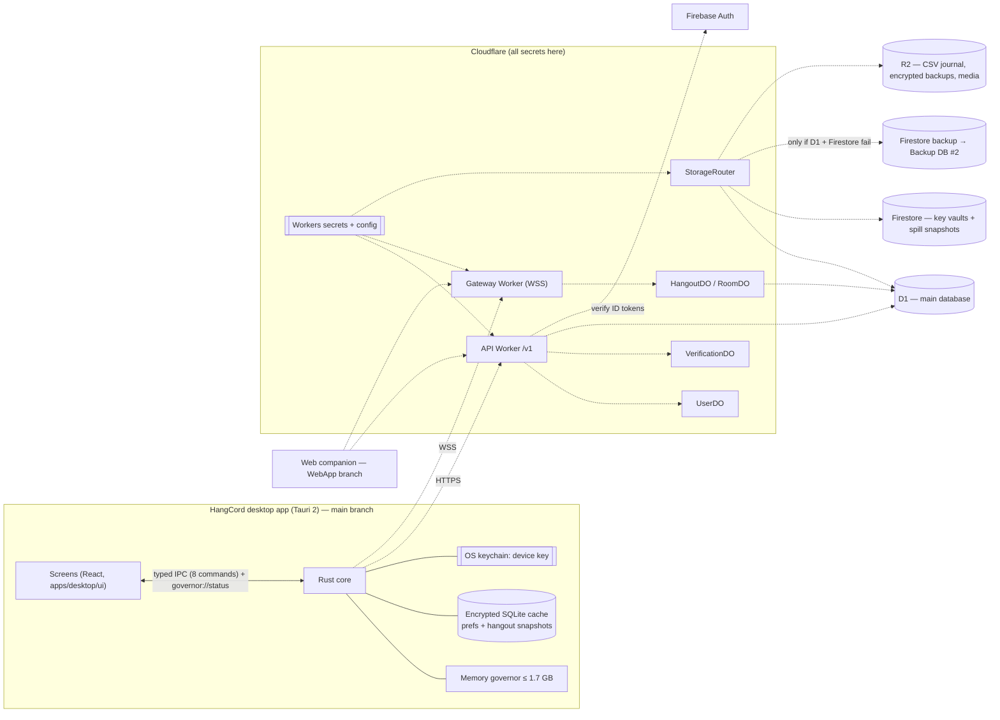
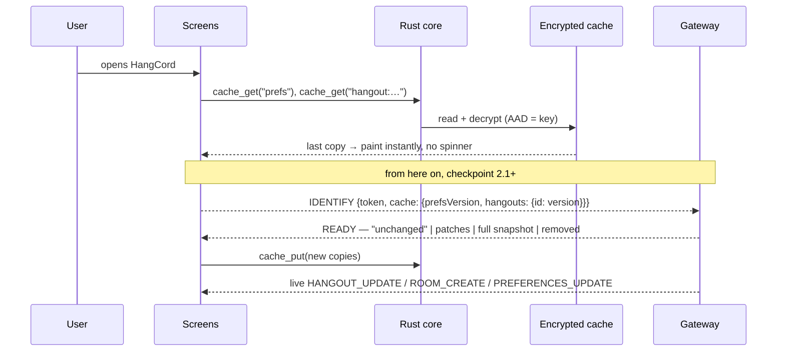
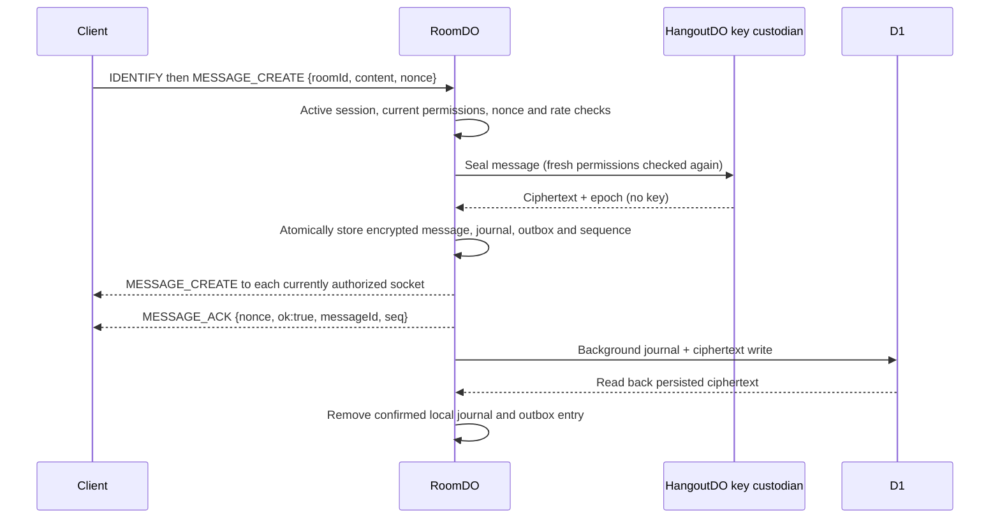
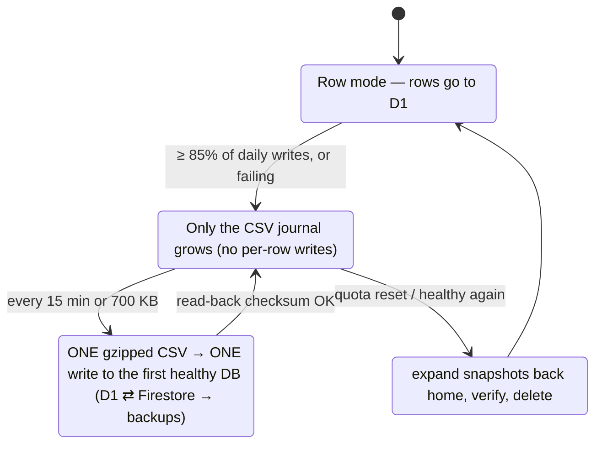
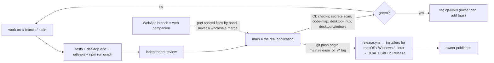
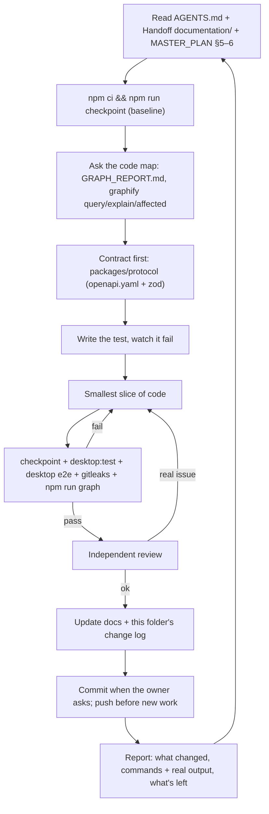

# Workflow design

How the app, the API and the work itself flow. These diagrams summarise `docs/MASTER_PLAN.md` §5 (the full system map lives there and is the source of truth). If code and a diagram disagree, fix the diagram or the code **first**, in the same change. Don't build from memory.

Legend: **solid** = exists in `main` today · **dashed** = designed, being built in checkpoint 2 and later.

## 1. App ↔ API ↔ storage (big picture)


## 2. Opening the app (cache first, then sync)

**Rule:** the cache only makes things fast. Every action is checked again on the server with `computePermissions()`.

## 3. Signing in (checkpoint 2.2; Firebase configuration stays in Cloudflare)
```mermaid
sequenceDiagram
  participant A as Desktop app
  participant B as System browser
  participant W as API Worker
  participant F as Firebase Auth / Google
  alt Continue with Google
    A->>B: open Google sign-in (PKCE, loopback 127.0.0.1:<port>)
    B-->>A: auth code (loopback)
    A->>W: POST /auth/google/exchange {code, verifier}
    W->>F: exchange (client secret stays in Workers secrets)
  else Email + password
    A->>W: credentials (TLS; Firebase configuration stays in the Worker)
    W->>F: Identity Toolkit REST (key from Workers config)
  end
  F-->>W: Firebase ID token
  W->>W: verify RS256 against Google's keys; email/password must be verified
  W-->>A: HangCord session (15 min) + single-use refresh token
  A->>A: keep both in the OS keychain
```

## 4. Sending a message (checkpoint 2.1, locally verified)
Desktop integration and its optimistic outbox belong to checkpoint 2.2. This server path is working in local integration tests:


An alarm retries failed D1 writes; the local journal remains until read-back succeeds. REST fallback send and history use the same RoomDO. Successful nonce retries return the original message and sequence. This is not yet encrypted CSV sealing or tier failover.

## 5. Storage when a free quota runs out (MASTER_PLAN §8.3)


## 6. Git, branches and releases


## 7. How an agent works (every task)


## 8. Where each rule is enforced
| Rule | Enforced by |
|---|---|
| Docs ⊆ contract | `packages/protocol/test/contract.test.ts` |
| Permission bits match the docs | `packages/protocol/test/permissions.test.ts` |
| No secrets in config, private folders ignored, ≤ 5 crons, layout and design rules | `tools/policy/test/policy.test.ts` |
| No leaked secrets | gitleaks (CI `secrets-scan`, `.gitleaks.toml`) |
| Code map is fresh and private-safe | CI `code-map` (`graphify/refresh.sh --check`) + policy tests |
| The built app really works | `tests/desktop/run.mjs` (CI `desktop-linux`) |
| Screens work at desktop sizes | `tests/ui` (Playwright + axe) |
