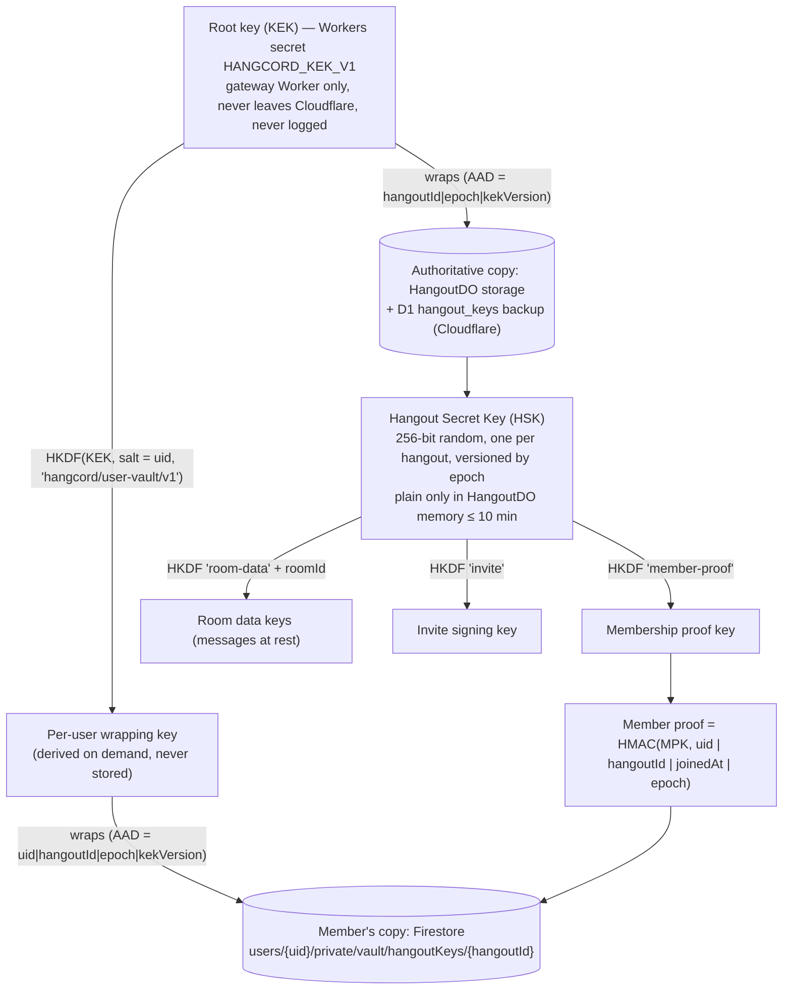
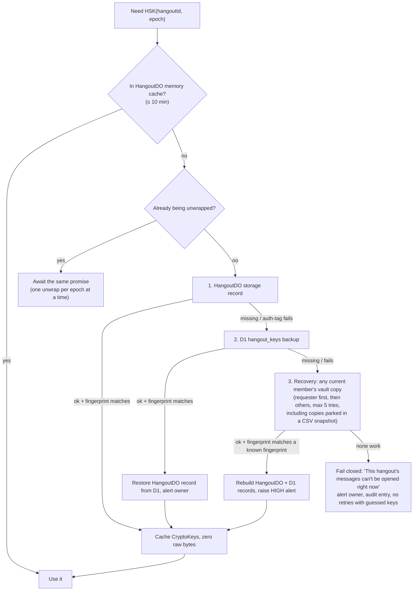

# HangCord — Access, Settings and Hangout Keys (spec)

> Agent: this is the source of truth for roles, permissions, hangout/room settings and hangout secret keys. Build exactly this. If something is missing, add it here first (Architect role), then code it. Security mistakes here hurt real people — go slowly, test every rule, and never "simplify" a check away.

Status: spec v1, 2026-10-21. Parent doc: `MASTER_PLAN.md`. Secrets register: `SECRETS_AND_SENSITIVE_DATA.md`.

## Contents
1. Principles
2. Who's who: owner, roles, members
3. Permission flags (HangCord's own bit layout)
4. Computing permissions
5. Hierarchy: who can manage whom
6. Role settings
7. Room settings (per room type)
8. Hangout settings
9. Member state inside a hangout
10. Hangout secret key (server-side, per-user vault copies, exact decryption procedure §10.6)
11. Step-up confirmation for sensitive actions
12. Audit log (tamper-evident)
13. Data model (D1 + Firestore) and Firestore rules
14. API additions
15. Threat model
16. Tests that must exist

---

## 1. Principles
1. **Deny by default.** Every request is checked server-side in the Worker / Durable Object. The client's permission view is only for showing/hiding UI.
2. **One function decides.** All checks call `computePermissions(member, room)` in `packages/protocol/permissions.ts` (shared by Workers and UI). No ad-hoc checks.
3. **Least privilege.** New roles start with the safe preset, never Administrator.
4. **Explainable.** Every permission result can be explained ("allowed by role Moderator, overridden by member deny in #exams").
5. **Server never trusts the database alone.** Memberships carry a cryptographic proof made with the hangout's secret key (§10), so a database-only compromise can't forge access.
6. **Sensitive actions need step-up** (fresh email code, §11).
7. **Everything administrative is audited** in a hash-chained log (§12).

## 2. Who's who
- **Owner:** exactly one per hangout. Has every permission, can't be timed out, kicked or banned, is not subject to hierarchy. Owner-only actions: transfer ownership, delete hangout, rotate hangout key, change the "sensitive actions need step-up" policy, grant/revoke Administrator.
- **@everyone role:** every hangout has one; id = hangout id; position 0; can't be deleted, renamed, coloured or hoisted; **can never hold `ADMINISTRATOR`, `BAN_MEMBERS`, `KICK_MEMBERS`, `MANAGE_ROLES`, `MANAGE_HANGOUT` or `MANAGE_ROOMS`** (API rejects it).
- **Roles:** up to **250** per hangout, ordered by `position` (higher = more power; ties broken by id).
- **Members:** a user in a hangout, with roles, nickname, flags and state (§9).

## 3. Permission flags

Stored as an unsigned 64-bit bitfield, sent over the API as a **decimal string** and handled with `BigInt` in TypeScript (`u64` in Rust). Bits 0–63; unassigned bits must be zero (API rejects unknown bits). Column **Scope**: H = hangout-wide only, R = can be set per room (overrides). **Risk**: ⚠ = dangerous (step-up + warning when granted), ★ = owner/admin-level.

| Bit | Name | Scope | Risk | Allows |
|---|---|---|---|---|
| 0 | `VIEW_ROOM` | R | | See the room, read live messages, see a lounge |
| 1 | `READ_HISTORY` | R | | Load messages sent before you opened the room |
| 2 | `SEND_MESSAGES` | R | | Post in rooms; create posts in Boards |
| 3 | `SEND_IN_STRANDS` | R | | Post inside Strands |
| 4 | `CREATE_PUBLIC_STRANDS` | R | | Start public Strands |
| 5 | `CREATE_PRIVATE_STRANDS` | R | | Start invite-only Strands |
| 6 | `EMBED_LINKS` | R | | Links show previews |
| 7 | `ATTACH_FILES` | R | | Upload files/images |
| 8 | `ADD_REACTIONS` | R | | Add new reactions (joining existing ones always allowed unless timed out) |
| 9 | `USE_EXTERNAL_EXPRESSIONS` | R | | Use emoji/stickers/sounds from other hangouts |
| 10 | `MENTION_EVERYONE` | R | ⚠ | Use @everyone, @here, and mention any role |
| 11 | `SEND_VOICE_MESSAGES` | R | | Voice notes |
| 12 | `SEND_POLLS` | R | | Polls |
| 13 | `USE_COMMANDS` | R | | Slash commands / bot commands |
| 14 | `SCHEDULE_MESSAGES` | R | | Schedule messages in this room |
| 15 | `BYPASS_SLOWMODE` | R | | Ignore slow mode |
| 16 | `PIN_MESSAGES` | R | | Pin/unpin |
| 17 | `MANAGE_MESSAGES` | R | ⚠ | Delete others' messages, remove reactions |
| 18 | `MANAGE_STRANDS` | R | ⚠ | Rename, lock, archive, delete Strands; see private Strands |
| 19 | `CONNECT` | R | | Join a Lounge/Spotlight |
| 20 | `SPEAK` | R | | Talk in a Lounge |
| 21 | `CAMERA` | R | | Turn on video |
| 22 | `SHARE_SCREEN` | R | | Share screen |
| 23 | `USE_VOICE_ACTIVITY` | R | | Talk without push-to-talk |
| 24 | `PRIORITY_SPEAKER` | R | | Lower others' volume while speaking |
| 25 | `USE_SOUNDBOARD` | R | | Play soundboard sounds |
| 26 | `SET_LOUNGE_STATUS` | R | | Set the lounge's status line |
| 27 | `REQUEST_TO_SPEAK` | R | | Raise hand in a Spotlight |
| 28 | `MUTE_MEMBERS` | R | ⚠ | Server-mute others |
| 29 | `DEAFEN_MEMBERS` | R | ⚠ | Server-deafen others |
| 30 | `MOVE_MEMBERS` | R | ⚠ | Move/disconnect people from lounges |
| 31 | `START_TOGETHER` | R | | Start watch/listen-together in a lounge |
| 32 | `CONTROL_TOGETHER` | R | | Control playback started by others |
| 33 | `USE_WHITEBOARD` | R | | Draw on the lounge whiteboard |
| 34 | `MANAGE_WHITEBOARD` | R | | Clear/lock/export the whiteboard |
| 35 | `USE_AI_CATCHUP` | R | | "Catch me up" summaries |
| 36 | `USE_TRANSLATION` | R | | Translate messages |
| 37 | `CREATE_INVITES` | R | | Create invites |
| 38 | `MANAGE_ROOM_PERMISSIONS` | R | ⚠ | Edit this room's overrides (only bits you hold) |
| 39 | `MANAGE_WEBHOOKS` | R | ⚠ | Create/edit webhooks |
| 40 | `MANAGE_ROOMS` | H/R | ⚠ | Create, edit, delete rooms and categories |
| 41 | `CREATE_EVENTS` | H/R | | Create events, manage own |
| 42 | `MANAGE_EVENTS` | H/R | | Manage all events |
| 43 | `CHANGE_NICKNAME` | H | | Change own nickname |
| 44 | `MANAGE_NICKNAMES` | H | | Change others' nicknames (hierarchy) |
| 45 | `CREATE_EXPRESSIONS` | H | | Upload emoji/stickers/sounds, manage own |
| 46 | `MANAGE_EXPRESSIONS` | H | ⚠ | Manage all expressions |
| 47 | `TIMEOUT_MEMBERS` | H | ⚠ | Time out (hierarchy) |
| 48 | `KICK_MEMBERS` | H | ⚠ | Kick (hierarchy) |
| 49 | `BAN_MEMBERS` | H | ⚠ | Ban/unban (hierarchy) |
| 50 | `MANAGE_INVITES` | H | | See and revoke all invites, pause invites |
| 51 | `VIEW_AUDIT_LOG` | H | | Read the audit log |
| 52 | `VIEW_INSIGHTS` | H | | Activity insights |
| 53 | `VIEW_SAFETY_ALERTS` | H | | See raid/spam alerts |
| 54 | `MANAGE_SECURITY_ACTIONS` | H | ⚠ | Pause invites/DMs, raise verification during incidents |
| 55 | `MANAGE_AUTOMOD` | H | ⚠ | AutoMod rules |
| 56 | `MANAGE_ROLES` | H/R | ⚠ | Create/edit/assign roles below own highest role, only bits you hold |
| 57 | `MANAGE_HANGOUT` | H | ⚠ | Edit hangout settings (not owner-only items) |
| 58 | `VIEW_AS_ROLE` | H | | Preview the hangout as a role (read-only) |
| 59 | `ADMINISTRATOR` | H | ★ | All permissions, skips overrides. Owner-granted only, step-up required |
| 60–63 | reserved | | | Must be 0 (reserved for HangCord Plus / future) |

**Presets** (shown as one-click templates when creating a role):
- *Member:* `VIEW_ROOM, READ_HISTORY, SEND_MESSAGES, SEND_IN_STRANDS, CREATE_PUBLIC_STRANDS, EMBED_LINKS, ATTACH_FILES, ADD_REACTIONS, USE_EXTERNAL_EXPRESSIONS, SEND_VOICE_MESSAGES, SEND_POLLS, USE_COMMANDS, SCHEDULE_MESSAGES, CONNECT, SPEAK, CAMERA, SHARE_SCREEN, USE_VOICE_ACTIVITY, USE_SOUNDBOARD, REQUEST_TO_SPEAK, START_TOGETHER, USE_WHITEBOARD, USE_AI_CATCHUP, USE_TRANSLATION, CREATE_INVITES, CREATE_EVENTS, CHANGE_NICKNAME, CREATE_EXPRESSIONS`. This is also the default for `@everyone` in a new hangout.
- *Moderator:* Member + `PIN_MESSAGES, MANAGE_MESSAGES, MANAGE_STRANDS, BYPASS_SLOWMODE, MUTE_MEMBERS, DEAFEN_MEMBERS, MOVE_MEMBERS, CONTROL_TOGETHER, MANAGE_WHITEBOARD, MANAGE_NICKNAMES, TIMEOUT_MEMBERS, KICK_MEMBERS, VIEW_AUDIT_LOG, VIEW_SAFETY_ALERTS, MANAGE_SECURITY_ACTIONS, VIEW_AS_ROLE`.
- *Admin (no Administrator flag):* Moderator + `MANAGE_ROOMS, MANAGE_ROOM_PERMISSIONS, MANAGE_ROLES, MANAGE_EVENTS, MANAGE_EXPRESSIONS, MANAGE_INVITES, MANAGE_WEBHOOKS, BAN_MEMBERS, MANAGE_AUTOMOD, MANAGE_HANGOUT, VIEW_INSIGHTS, MENTION_EVERYONE`.

## 4. Computing permissions

```ts
// packages/protocol/permissions.ts — reference algorithm (pure function, no I/O)
function computePermissions(ctx: {
  hangout, member, room /* may be undefined for hangout-level */, now: number
}): { bits: bigint; explain: ExplainStep[] } {
  if (member.userId === hangout.ownerId) return ALL_BITS;           // 1. owner
  let base = roleBits(hangout.everyoneRole);                         // 2. @everyone
  for (const r of member.roles) base |= roleBits(r);                 // 3. OR all roles
  if (base & ADMINISTRATOR) return ALL_BITS;                         // 4. admin
  let p = base;
  if (room) {                                                        // 5. room overrides
    const ow = effectiveOverrides(room);  // room's own, or its category's when synced
    p = (p & ~ow.everyone.deny) | ow.everyone.allow;
    let rd = 0n, ra = 0n;
    for (const r of member.roles) { rd |= ow.role(r).deny; ra |= ow.role(r).allow; }
    p = (p & ~rd) | ra;                                              //    role allow beats role deny
    p = (p & ~ow.member(member.userId).deny) | ow.member(member.userId).allow;
  }
  if (member.timeoutUntil > now) p &= (VIEW_ROOM | READ_HISTORY);   // 6. timeout mask
  if (member.flags & PENDING) p &= (VIEW_ROOM | READ_HISTORY);      // 7. not yet accepted rules
  if (!gateSatisfied(hangout.verificationLevel, member, now))        // 8. verification gate
    p &= (VIEW_ROOM | READ_HISTORY);
  p = applyImplicit(p, room);                                        // 9. implicit rules
  p &= hangoutPolicyMask(hangout);                                   // 10. hangout-wide kill switches
  return p;
}
```
Implicit rules (`applyImplicit`):
- No `VIEW_ROOM` → result is 0 for that room.
- No `SEND_MESSAGES` → clear `MENTION_EVERYONE, ATTACH_FILES, EMBED_LINKS, SEND_VOICE_MESSAGES, SEND_POLLS, SCHEDULE_MESSAGES` for posting in the room itself (Strands use `SEND_IN_STRANDS`).
- Lounge without `CONNECT` → clear all voice/Together/whiteboard bits.
- Strands inherit the parent room's result; to see any Strand you must see the parent; private Strands are visible only to their members and `MANAGE_STRANDS` holders.
- Age-restricted rooms: hidden unless the user confirmed they're an adult (account flag) — HangCord's minimum age policy still applies.
- Room schedule closed (§7) → clear send/connect bits for everyone except `MANAGE_ROOMS` holders.

Hangout-wide kill switches (`hangoutPolicyMask`): during *Security actions* (§8) invites are refused and DMs between non-friend members are blocked; these are checked in the invite and DM paths too.

**Caching.** The HangoutDO keeps a per-member cache `{roomId → bits}` and a `permVersion` counter. Any change to roles, overrides, member roles, timeout, ownership or verification level bumps `permVersion` and pushes `PERMISSIONS_UPDATE` to affected clients. Cache entries older than `permVersion` are recomputed.

**Explainer.** Every step that changes a bit records `{step, source: 'role'|'override'|'timeout'|..., id, bit, from, to}`. `GET /hangouts/:id/members/:uid/permissions?room=` (needs `VIEW_AS_ROLE` or asking about yourself) returns bits + explanation; the UI shows "Why?" next to each toggle.

## 5. Hierarchy

`highest(m)` = max `position` among the member's roles (0 if only @everyone). The actor `a` may act on target `t` only if:

| Action | Rule |
|---|---|
| Kick / ban / timeout / change nickname / move / mute / deafen | `a` has the permission AND (`a` is owner OR `highest(a) > highest(t)`) AND `t` is not the owner. Admin targets can't be timed out. |
| Create role | `a` has `MANAGE_ROLES`; new role is placed directly below `highest(a)` (never above) |
| Edit / delete / reorder role `r` | `a` has `MANAGE_ROLES` AND `r.position < highest(a)`; can't move any role to ≥ `highest(a)` |
| Grant bits on a role or override | only bits `a` currently holds (in that room for overrides); `ADMINISTRATOR` only by owner |
| Assign / remove role `r` to a member | `r.position < highest(a)` AND target rule above |
| Self-lockout guard | Reject an edit that would remove `MANAGE_ROLES` / `MANAGE_ROOM_PERMISSIONS` from the actor's own effective permissions unless the actor confirms (`confirmSelfLockout: true`) |

Managed roles (created by bots/integrations) can't be assigned by hand or deleted while the integration exists.

## 6. Role settings

| Field | Rules |
|---|---|
| `name` | 1–100 chars, trimmed, no control characters; unique per hangout (case-insensitive) |
| `color` | 24-bit hex or null (no colour) |
| `icon` | uploaded image (≤ 256 KB, 128×128) or one emoji; no Plus gate |
| `hoist` | show members separately in the list |
| `mentionable` | anyone can @mention it (else only `MENTION_EVERYONE` holders) |
| `position` | integer; see hierarchy |
| `permissions` | bitfield (§3) |
| `selfAssignable` | members can pick it in onboarding / Channels & Roles (never if role holds any ⚠ bit) |
| `expiresAfter` | optional duration for **time-limited roles**: when assigned, the role auto-removes after it (DO alarm) |
| `managed` | read-only; set by integrations |

UI: role list with drag-to-reorder (only roles below yours are draggable), presets, search, risk badges on ⚠ bits, "View as role" button, member count per role.

## 7. Room settings

Common to all rooms: `name` (1–100, lowercase-dashes for text rooms), `type` (`text`, `lounge`, `spotlight`, `board`, `bulletin`, `category`), `categoryId`, `position`, `topic` (≤ 1024; Boards ≤ 4096), `ageRestricted`, `overrides[]`, `syncWithCategory` (bool; editing overrides sets it false and the UI shows "Not synced — Sync now"), `schedule` (optional weekly open hours in the hangout's time zone; HangCord original), `private` (UI shortcut that writes the overrides).

| Type | Extra settings (defaults) |
|---|---|
| `text` | `slowmode` 0–21,600 s in steps (0, 5, 10, 15, 30 s, 1, 2, 5, 10, 15, 30 min, 1, 2, 6 h); `strandAutoArchive` 1 h/1 d/3 d/1 w (3 d); `strandSlowmode`; `translateDefault` (off) |
| `lounge` | `userLimit` 0–99 (0); `bitrate` 32–128 kbps (64) — not tied to any paid tier; `videoQuality` auto/full (auto); `region` auto or a LiveKit region; `togetherAllowed` (on); `whiteboardAllowed` (on); `status` (≤ 100 chars) |
| `spotlight` | `audienceLimit` (by SFU capacity), `speakers[]`, `requestToSpeak` (on), `topic` |
| `board` | `tags[]` ≤ 20 (name ≤ 20, `modOnly` flag, emoji), `requireTag` (off), `defaultReaction`, `sort` latest-activity/created, `layout` list/gallery, `postSlowmode`, `guidelines` |
| `bulletin` | `followable` (on), max 10 follows per bulletin |
| `category` | holds ≤ 50 rooms; its **guidelines** (overrides + `roomDefaults` + `guidelinesText`, §7.1) are the template for synced children. `roomDefaults`: `slowmode`, `ageRestricted`, `translateDefault`, `notifyDefault` (all / mentions / nothing); `guidelinesText` ≤ 2,000 chars |

Hangout limits: 500 rooms total, 50 categories, 50 rooms per category, 1,000 members per Strand.

### 7.1 Adding rooms from a category — the **+** button (owner request, 2026-10-21)
Every category header in the rooms list has a round **+** button, and so does the top of the list for rooms that sit outside any category. It adds a text **Room** or a voice **Lounge** (Spotlight, Board and Bulletin sit under "More types") **inside that category**.

**Who sees it:** only people for whom `computePermissions(member, category)` includes `MANAGE_ROOMS`. Everyone else sees no button (not a disabled one). The server re-checks on create; the client view is cosmetic. When the category already holds 50 rooms (or the hangout 500), the button stays visible but disabled with "This category is full (50 rooms)".

**What it opens:** "Add to ‹category›" — a dialog on desktop, a bottom sheet on phones — with:
1. Type: Room (text) or Lounge (voice), plus "More types".
2. Name (text rooms are shown lowercase-with-dashes as you type).
3. **Guidelines** — one choice, pre-selected from the creator's preference (below):
   - **Follow category guidelines** (`guidelines: "category"`): `syncWithCategory = true`. The room takes the category's overrides, `roomDefaults` and `guidelinesText`, and keeps following them when the category changes.
   - **Own guidelines** (`guidelines: "own"`): `syncWithCategory = false`. The room **starts as an exact copy** of the category's guidelines (so it can never start more open than its category), and the creator edits them right there: private on/off, who can see / talk / connect, slowmode (or user limit for Lounges), age restriction, guidelines text. Only permission bits the creator holds can be granted (§5).
4. "Create" adds the room at the bottom of the category; it can be dragged after.

**Rules the server enforces (shared code: `packages/protocol/src/rooms.ts`, used by the API and by the apps so both agree):**
- Own guidelines are compared with the category's copy as a **diff**. For every role/member target, a bit that becomes allowed **or stops being denied** counts as *opened*; every opened bit must be one the creator holds. Removing a category's deny (e.g. sending an empty override list) is opening it.
- Changing the copied overrides at all also needs `MANAGE_ROOM_PERMISSIONS`; an unchanged copy doesn't.
- Bits must be valid u64 decimal strings with only assigned, room-scoped bits; a bit can't be both allowed and denied; one entry per target.
- Categories can't be created inside categories; names must keep at least one letter or number (text rooms are slugged the same way on client and server).
- Errors: `forbidden`, `needs_manage_room_permissions`, `grants_exceed_creator` (403) · `bad_bits`, `not_a_category`, `nested_category`, `bad_name` (400) · `category_full`, `hangout_full` (409).

**Guidelines** = the category's permission overrides **+** its `roomDefaults` **+** its `guidelinesText`. A synced room follows all three. Editing any of them inside the room switches it to own guidelines and shows "Not synced — Sync now" (`POST /rooms/:id/sync` brings it back).

**User preference** `rooms.newRoomGuidelines`: `"category"` (default) / `"own"` / `"ask"` (nothing pre-selected), set in Settings → Hangouts, with an optional per-hangout value. It only chooses the pre-selected option; it never changes permissions. Stored and cached like every other preference (MASTER_PLAN §7.1).

**Mobile:** the + is a 44 px target on every touch screen (phones in either orientation, touch tablets); the sheet opens above the keyboard; long-press (right-click on desktop) on a room in the category opens the same "Add to ‹category›" sheet; the system back button closes it.

## 8. Hangout settings

| Section | Settings |
|---|---|
| **Overview** | name (2–100), icon, banner, description (≤ 300), system room + toggles (join messages, tips), inactive lounge + timeout (1/5/15/30/60 min), default notifications (all / mentions), time zone (for room schedules), locale |
| **Roles** | §6 |
| **Expressions** | emoji ≤ 100, stickers ≤ 30, soundboard ≤ 24 (free for everyone; raise later via config only) |
| **Members** | search, role assignment, timeouts (60 s / 5 m / 10 m / 1 h / 1 d / 1 w / custom ≤ 28 d), kick, ban (delete last 0 h / 1 h / 24 h / 7 d of messages), prune inactive (1–30 d, members without roles), transfer ownership (owner) |
| **Invites** | list with creator/uses/expiry, revoke, create with max age (30 min, 1 h, 6 h, 12 h, 1 d, 7 d, never), max uses (∞, 1, 5, 10, 25, 50, 100), temporary membership, **Pause invites** |
| **Safety** | Verification level: `open` → `verified email` (always true in HangCord since every account is verified) → `account ≥ 1 day old` → `member ≥ 10 min` → `account ≥ 7 days old`; explicit-media filter (off / members without roles / everyone; runs on-device); rules screening (≤ 16 rules, pending members can only read); DM protection (members can't DM each other unless friends: off/on); raid protection (join-rate threshold → Cloudflare Turnstile CAPTCHA for new joiners for up to 1 h + alert); activity alerts room; **Security actions** (pause invites and/or member DMs for 1 h–24 h, banner shows end time, resolve with note) |
| **AutoMod** | keyword rules (≤ 6, ≤ 1,000 keywords × 60 chars, wildcards), regex (≤ 10 × 260 chars, linear-time engine only), presets (profanity, sexual content, slurs), spam rule, mention-spam (≤ 50 unique mentions, raid detection), profile rule; actions: block with custom note (≤ 150 chars), alert to room, timeout (≤ 28 d), block interactions; exempt roles ≤ 20, rooms ≤ 50 |
| **Audit log** | §12; filter by actor, action, target, date |
| **Bans** | list, reason, unban |
| **Onboarding** | default rooms (≥ 5 recommended), questions (pre-join / post-join, single/multi, required), answers grant self-assignable roles and rooms; welcome screen (≤ 5 rooms) |
| **Integrations** | webhooks (secret URL shown once, then only a hint; regenerate), bots and their managed roles, command permissions |
| **Security** (owner) | hangout key fingerprint, last rotation, **Rotate key**; "Moderators need an email code for sensitive actions" (on by default); active security actions |
| **Danger zone** (owner) | transfer ownership, delete hangout (soft delete, restorable for 7 days, then purged) |

## 9. Member state inside a hangout

`nickname` (≤ 32), `hangoutAvatar`, `roles[]`, `joinedAt`, `timeoutUntil`, `flags` (`PENDING` rules not accepted, `ONBOARDED`, `REJOINED`, `BYPASS_VERIFICATION` set by mods, `QUARANTINED` by AutoMod profile rule), voice `serverMute`/`serverDeaf`, `notificationPrefs`, `onboardingAnswers`, `keyEpoch`.

## 10. Hangout secret key

The owner asked that every hangout have a **secret key kept privately**, and that each member's copy be **stored encrypted, deep inside a "private" folder of that user's profile in the database, until they leave**. Design:

### 10.1 Key hierarchy and where every copy lives

- **HSK** is created with `crypto.getRandomValues(32 bytes)` when the hangout is created. It is never stored or sent anywhere in plain form; the plain key exists only in the HangoutDO's memory for at most 10 minutes. The UI shows only a **fingerprint** (first 8 bytes of SHA-256 of the HSK, hex, e.g. `9f3a 77c1 0b2e d4a8`).
- **Authoritative copy (Cloudflare):** wrapped with the KEK (AES-256-GCM, random 96-bit IV, AAD = `hangoutId|epoch|kekVersion`) in the HangoutDO's Durable Object storage, with the same ciphertext backed up in D1 `hangout_keys`.
- **Member's copy (owner's request):** every member's profile holds their own encrypted copy in a **private vault folder**: `users/{uid}/private/vault/hangoutKeys/{hangoutId}` in Firestore. It is wrapped with a **per-user key** derived from the KEK and that user's uid (HKDF-SHA256), with AAD = `uid|hangoutId|epoch|kekVersion`. So:
  - every member's copy is different ciphertext;
  - a copy can't be moved to another user's profile or another hangout (the AAD check fails);
  - a leaked Firestore export is useless without the KEK, which never leaves Cloudflare's Workers Secrets;
  - the client never reads the vault (Firestore rules deny all client access, §13) and never receives the key.
- Rule kept from the secrets register: secrets themselves (the KEK, plain keys) stay on Cloudflare; Firestore holds **only locked copies**.

### 10.2 The member's private vault document
On join (after invite checks, bans, verification, Turnstile if required), the Worker writes, in the same operation as the D1 member row:
```
users/{uid}/private/vault/hangoutKeys/{hangoutId} = {
  hangoutId, joinedAt, epoch, kekVersion,
  iv:          base64(12 bytes),
  wrappedKey:  base64(AES-256-GCM(UWK(uid), HSK, iv, AAD = uid|hangoutId|epoch|kekVersion)),
  proof:       base64(HMAC-SHA256(MPK, uid|hangoutId|joinedAt|epoch)),
  createdBy: "worker", v: 2
}
```
On every permission-relevant request the HangoutDO checks the member's `proof` (constant time). On join, rotation and the daily reconciler it also checks that the vault copy **unwraps to the same fingerprint** as the authoritative key. Any mismatch → treat as **not a member**, raise a security alert, write an audit entry. Someone who can write to Firestore or D1 but doesn't hold the KEK can neither forge a membership nor plant a key.

### 10.3 Removal "until they leave"
The vault document and the D1 member row are **deleted in the same operation** when the member leaves, is kicked, is banned, deletes their account, or the hangout is deleted. A daily Cron reconciler compares D1 members with Firestore vaults, deletes orphan vault documents, and alerts if a vault document has no D1 row (possible tampering).

**If Firestore can't take the delete** (daily delete quota used up or Firestore down): the D1 member row is still deleted immediately, so access ends at once (the leftover vault copy is useless — only the server can open it, and it no longer recognises the member). The vault delete is written as a tombstone row into the CSV journal and applied by the restore job when Firestore is healthy again (MASTER_PLAN §8.3).

### 10.4 What the key also protects
- **Messages at rest:** message bodies of hangout rooms are encrypted with the room data key (AES-256-GCM) before going to D1, Firestore, or the R2 journal/chunks. A leaked database export or snapshot reveals nothing readable. (Hangout rooms are not end-to-end encrypted — the server needs plaintext for search, AutoMod, AI catch-up and translation. DMs remain end-to-end encrypted with MLS.)
- **Invites:** invite codes are random (10 chars base62); the invite record carries `HMAC(IVK, code|hangoutId|expiry|maxUses)` so tampered invite rows are rejected.

### 10.5 Rotation
- **Owner-triggered** (Security → Rotate key, needs step-up §11), **automatic every 180 days**, and **forced** after any tamper alert or suspected leak.
- Rotation creates HSK epoch `n+1`. New messages use the new room keys immediately; old epochs stay in the authoritative store (wrapped, read-only) so history still decrypts. Each member's vault copy is re-wrapped to the new epoch (with a new proof) by a background Queue job within Firestore's daily write quota, plus lazily on the member's next request; old-epoch vault copies are deleted once replaced. **When Firestore's writes run out or it is down, the CSV technique applies (MASTER_PLAN §8.3):** the re-wrapped copies go into the CSV journal as rows (`uid, hangoutId, epoch, kekVersion, iv, wrappedKey, proof, joinedAt`), are packed into one snapshot, and stored as **one write** in D1 (or, if D1 has failed too, in the Firestore backup, then Backup DB #2 — MASTER_PLAN §8.3); when Firestore recovers they are expanded back into each member's vault document and the snapshot is deleted. Until a member's new copy lands, their previous-epoch copy and proof stay valid (unless the rotation was forced by a compromise, in which case membership is checked against the D1 member row only). Warm/cold archives are re-encrypted over time within quota.
- KEK rotation: add `HANGCORD_KEK_V2`, re-wrap the authoritative copies and every member's vault copy in Queue jobs, then remove V1.

### 10.6 Decrypting hangout keys — exact procedure

> Follow this word for word. Every byte format, label and order below is fixed; changing any of them makes existing data undecryptable. Reference code lives in `packages/crypto/hangoutKeys.ts` and must match this section exactly.

**Who decrypts.** Only server code inside the gateway Worker's `HangoutDO`, after the permission check for the request has passed. A member "needs" the key whenever they read history, send a message, join, accept an invite, or open a whiteboard/Together session — in every case the server decrypts on their behalf and sends them only the result (e.g. plaintext messages over TLS). The plain key, derived keys and the KEK are never returned to any client, member or owner.

#### A. Fixed formats
| Item | Format |
|---|---|
| `HANGCORD_KEK_V{n}` | base64 of exactly 32 random bytes. Decoded length ≠ 32 → Worker refuses to start. |
| KEK use | Imported **only** as an `HKDF` key (non-extractable). It is never used directly for encryption; two sub-keys are derived from it (below). |
| HSK | exactly 32 random bytes (`crypto.getRandomValues`) |
| IV | 12 random bytes per encryption, never reused with the same key |
| AES-GCM | 256-bit key, 128-bit tag, `additionalData` = AAD below |
| AAD / labels | UTF-8 of the parts joined with a single `\|` (no spaces); numbers as plain decimal (`epoch` = 1, 2, 3…; `kekVersion` = 1, 2…); ids exactly as stored (`uid` = Firebase uid, `hangoutId`/`roomId`/`messageId` = HangCord ids) |
| Encoding in storage | `iv`, `wrappedKey`, `ct`, `proof` = standard base64 with padding |
| Fingerprint | first 8 bytes of SHA-256(HSK), lowercase hex, stored next to every authoritative record and shown in groups of 4 (`9f3a 77c1 0b2e d4a8`) |

#### B. Key derivations (HKDF-SHA-256, all keys non-extractable)
| Derived key | Input key | salt (UTF-8) | info (UTF-8) | Result |
|---|---|---|---|---|
| KEK wrap key | KEK | `hangcord` | `hangcord/kek-wrap/v1` | AES-GCM 256, encrypt/decrypt |
| Per-user vault key | KEK | `{uid}` | `hangcord/user-vault/v1` | AES-GCM 256, encrypt/decrypt |
| Room data key | HSK | `{roomId}` | `hangcord/room-data/v1` | AES-GCM 256, encrypt/decrypt |
| Membership proof key | HSK | `{hangoutId}` | `hangcord/member-proof/v1` | HMAC-SHA-256, sign/verify |
| Invite key | HSK | `{hangoutId}` | `hangcord/invite/v1` | HMAC-SHA-256, sign/verify |

"Wrapped with the KEK" anywhere in these docs means "encrypted with the **KEK wrap key**".

#### C. What each ciphertext is bound to (AAD)
| Ciphertext | Key | AAD |
|---|---|---|
| Authoritative HSK (HangoutDO storage, D1 `hangout_keys`) | KEK wrap key | `{hangoutId}\|{epoch}\|{kekVersion}` |
| Member vault copy (Firestore `users/{uid}/private/vault/hangoutKeys/{hangoutId}`) | per-user vault key of `{uid}` | `{uid}\|{hangoutId}\|{epoch}\|{kekVersion}` |
| Message body at rest | room data key of the message's **own** epoch | `{hangoutId}\|{roomId}\|{messageId}\|{epoch}` |
| Membership proof | proof key | HMAC over `{uid}\|{hangoutId}\|{joinedAt ms}\|{epoch}` |

Every stored message carries `{v: 1, epoch, iv, ct}`. **Always decrypt with the epoch written on the message — never "the current epoch".**

#### D. Getting the plain HSK for `(hangoutId, epoch)` — source order

Rules for this flow:
1. **Pick the KEK by the record's `kekVersion`** (`HANGCORD_KEK_V{kekVersion}`). If that secret is missing → fail closed + alert; never try other versions.
2. **Check the fingerprint** after every unwrap: SHA-256 of the unwrapped bytes (first 8 bytes) must equal the fingerprint stored for that `(hangoutId, epoch)` in HangoutDO or D1. Mismatch = treat that source as failed.
3. An AES-GCM `OperationError` means wrong key or tampered data. Never retry the same source with a different epoch, uid or KEK; move to the next source in the order above.
4. Immediately import the 32 raw bytes as non-extractable `HKDF` key material, compute the fingerprint, then overwrite the raw buffer with zeros. Only `CryptoKey` objects are cached.
5. **Cache:** per `(hangoutId, epoch)`: the HSK `CryptoKey` and derived room/proof/invite keys, max 10 minutes, cleared on rotation, on memory pressure, and when the DO is evicted. Nothing is persisted.
6. Vault copies are a **recovery source and a membership check**, not the normal path. Normal reads/sends use sources 1–2. Vault copies parked in a CSV snapshot (MASTER_PLAN §8.3) count as vault copies: read the snapshot once, find the row for `(uid, hangoutId, epoch)`, and open it with exactly the same steps.
7. Never decrypt for a request that hasn't passed `computePermissions()` for the exact room and action.

#### E. Reference code (TypeScript, Workers WebCrypto)
```ts
const enc = new TextEncoder();
const aad = (...p: (string | number)[]) => enc.encode(p.join('|'));
const b64d = (s: string) => Uint8Array.from(atob(s), c => c.charCodeAt(0));

async function kekKey(env: Env, version: number): Promise<CryptoKey> {
  const b64 = (env as any)[`HANGCORD_KEK_V${version}`];
  if (!b64) throw new FatalKeyError(`KEK v${version} missing`);           // fail closed
  const raw = b64d(b64);
  if (raw.length !== 32) throw new FatalKeyError('KEK must be 32 bytes');
  return crypto.subtle.importKey('raw', raw, 'HKDF', false, ['deriveKey']);
}

const hkdfAes = (base: CryptoKey, salt: string, info: string) =>
  crypto.subtle.deriveKey({ name: 'HKDF', hash: 'SHA-256', salt: enc.encode(salt), info: enc.encode(info) },
    base, { name: 'AES-GCM', length: 256 }, false, ['encrypt', 'decrypt']);

const hkdfHmac = (base: CryptoKey, salt: string, info: string) =>
  crypto.subtle.deriveKey({ name: 'HKDF', hash: 'SHA-256', salt: enc.encode(salt), info: enc.encode(info) },
    base, { name: 'HMAC', hash: 'SHA-256', length: 256 }, false, ['sign', 'verify']);

async function openHsk(rawWrapped: { iv: string; wrappedKey: string }, key: CryptoKey, ad: Uint8Array,
                       expectedFingerprint: string): Promise<CryptoKey> {
  const raw = new Uint8Array(await crypto.subtle.decrypt(
    { name: 'AES-GCM', iv: b64d(rawWrapped.iv), additionalData: ad, tagLength: 128 }, key, b64d(rawWrapped.wrappedKey)));
  try {
    if (raw.length !== 32) throw new KeyIntegrityError('HSK length');
    const fp = [...new Uint8Array(await crypto.subtle.digest('SHA-256', raw))].slice(0, 8)
      .map(b => b.toString(16).padStart(2, '0')).join('');
    if (fp !== expectedFingerprint) throw new KeyIntegrityError('fingerprint mismatch');
    return await crypto.subtle.importKey('raw', raw, 'HKDF', false, ['deriveKey']);
  } finally { raw.fill(0); }
}

// Source 1/2: authoritative record { epoch, kekVersion, iv, wrappedKey, fingerprint }
async function openAuthoritative(env: Env, hangoutId: string, rec: KeyRecord) {
  const wrapKey = await hkdfAes(await kekKey(env, rec.kekVersion), 'hangcord', 'hangcord/kek-wrap/v1');
  return openHsk(rec, wrapKey, aad(hangoutId, rec.epoch, rec.kekVersion), rec.fingerprint);
}

// Source 3: member vault copy { epoch, kekVersion, iv, wrappedKey }
async function openVault(env: Env, uid: string, hangoutId: string, v: VaultDoc, fingerprint: string) {
  const vaultKey = await hkdfAes(await kekKey(env, v.kekVersion), uid, 'hangcord/user-vault/v1');
  return openHsk(v, vaultKey, aad(uid, hangoutId, v.epoch, v.kekVersion), fingerprint);
}

// Using the HSK
const roomKey  = (hsk: CryptoKey, roomId: string)    => hkdfAes(hsk, roomId, 'hangcord/room-data/v1');
const proofKey = (hsk: CryptoKey, hangoutId: string) => hkdfHmac(hsk, hangoutId, 'hangcord/member-proof/v1');

async function decryptMessage(hsk: CryptoKey, m: { hangoutId: string; roomId: string; id: string;
                              body: { v: 1; epoch: number; iv: string; ct: string } }) {
  const k = await roomKey(hsk, m.roomId);   // hsk MUST be the key for m.body.epoch
  const pt = await crypto.subtle.decrypt({ name: 'AES-GCM', iv: b64d(m.body.iv),
    additionalData: aad(m.hangoutId, m.roomId, m.id, m.body.epoch), tagLength: 128 }, k, b64d(m.body.ct));
  return new TextDecoder().decode(pt);
}

const verifyProof = async (hsk: CryptoKey, uid: string, hangoutId: string, joinedAt: number, epoch: number, proof: string) =>
  crypto.subtle.verify('HMAC', await proofKey(hsk, hangoutId), b64d(proof), aad(uid, hangoutId, joinedAt, epoch)); // constant time
```
Encryption is the mirror image (fresh 12-byte IV each time, same AAD rules). The fingerprint for a new HSK is computed before its raw bytes are zeroed.

#### F. Epochs and history
- Messages, archives and vault copies each record their `epoch`. Decryption always uses the stored epoch.
- A retired epoch's authoritative record is **never deleted** while any message, archive chunk or audit entry still references it (tracked in `hangout_keys.ref_count` and archive re-encryption progress). Only deleting the whole hangout removes it.
- After a key rotation, new messages use epoch `n+1`; reading old messages still opens epoch `n` through the same flow.

#### G. Failure handling the user sees
| Situation | What the member sees | What the server does |
|---|---|---|
| Brief storage error | nothing (retry once after 200 ms) | metric |
| Source 1 broken, D1 works | nothing | self-heal + owner alert |
| Recovery from vault copy | nothing | rebuild + HIGH alert + audit entry |
| No source works | "This hangout's messages can't be opened right now. The owner has been alerted." | fail closed, audit entry, no partial data |
| KEK version missing | same as above | deploy-blocking alert |

#### H. Performance budget
WebCrypto AES-GCM and HKDF are native and fast; with cached `CryptoKey`s a message decrypt is one AES-GCM call. Target: < 1 ms CPU per message decrypt after warm-up, first unwrap per epoch < 5 ms. Measure in CI against the Workers free-plan 10 ms CPU limit per request; batch history pages (≤ 50 messages) inside the Durable Object (30 s CPU budget) rather than in the stateless Worker.

## 11. Step-up confirmation
Because TOTP 2FA is deferred (MASTER_PLAN §6.1), sensitive actions require a **fresh 6-digit email code** (same code system, `purpose: step_up`, valid 5 minutes, 3 tries, stored only as an HMAC in `VerificationDO`; a correct code yields a single-use step-up token whose SHA-256 is kept in `UserDO` for 5 minutes, bound to the exact action + target):
- Owner: transfer ownership, delete hangout, rotate key, grant/revoke Administrator, change the step-up policy.
- Anyone (if the hangout policy is on, default on): granting any ⚠ permission, ban, kick, prune, bulk delete, editing AutoMod, creating webhooks, starting security actions.
- The step-up token is single-use and recorded in the audit entry.

## 12. Audit log
- Append-only table `audit_log(id, hangoutId, at, actorId, action, targetType, targetId, changes JSON, reason ≤ 512, stepUp bool, prevHash, hash)`.
- `hash = SHA-256(prevHash | canonicalJSON(entry))` → a tamper-evident chain per hangout; a Cron job verifies the chain daily and alerts the owner on a break.
- Retention 90 days in D1, then compressed to the archive tiers (encrypted with the room-data scheme using a dedicated `audit` key).
- Recorded actions: hangout settings, rooms (create/update/delete/override changes/sync), roles (create/update/delete/reorder/assign/remove/expire), members (join/leave/kick/ban/unban/timeout/nickname/prune/ownership), invites, webhooks, expressions, message deletes/pins/bulk deletes, Strands, events, AutoMod rules + actions, safety & security actions, key rotation, tamper alerts, onboarding, integrations.
- Members can't edit or delete entries; not even the owner.

## 13. Data model and Firestore rules

**D1 (hot, authoritative for access):**
```
hangouts(id, owner_id, name, icon, settings_json, verification_level, policy_flags, perm_version, created_at, deleted_at)
roles(id, hangout_id, name, color, icon, hoist, mentionable, position, permissions TEXT, self_assignable, expires_after, managed_by)
members(hangout_id, user_id, nickname, roles_json, joined_at, timeout_until, flags, key_epoch, proof, PRIMARY KEY(hangout_id, user_id))
rooms(id, hangout_id, type, category_id, position, name, topic, settings_json, sync_with_category, schedule_json)  -- categories keep roomDefaults + guidelinesText in settings_json (§7.1)
user_prefs(user_id PRIMARY KEY, version, prefs_json, updated_at)  -- user preferences incl. rooms.newRoomGuidelines (MASTER_PLAN §7.1); journaled + exported like every table
overrides(room_id, target_type, target_id, allow TEXT, deny TEXT, PRIMARY KEY(room_id, target_type, target_id))
bans(hangout_id, user_id, reason, banned_by, at)
invites(code, hangout_id, room_id, created_by, max_age, max_uses, uses, temporary, expires_at, mac)
hangout_keys(hangout_id, epoch, kek_version, wrapped_key, iv, fingerprint, ref_count, created_at, retired_at, PRIMARY KEY(hangout_id, epoch))
audit_log(...)  -- §12
automod_rules(id, hangout_id, json)
security_actions(hangout_id, invites_paused_until, dms_paused_until, raised_by, note)
```
**Cloudflare-only sensitive state** (never in Firestore): `HangoutDO` storage (authoritative wrapped hangout keys; Firestore gets only per-user locked copies, §10.2), `UserDO` (refresh-token hashes, step-up token hashes), `VerificationDO` (email-code HMACs), `RateLimitDO` (counters) — see `SECRETS_AND_SENSITIVE_DATA.md`.

Access data (members, roles, overrides, keys, bans) **always lives in D1** and is never rotated into the spill tiers; only message rows rotate (MASTER_PLAN §8). If D1 is unreachable, access checks fail **closed**. Every change to access data is still written to the CSV journal first and included in the daily encrypted CSV export (MASTER_PLAN §8.5), so D1 can always be rebuilt from CSV.

**Firestore:**
```
users/{uid}/private/vault/hangoutKeys/{hangoutId}   -- §10.2 member's encrypted key copy + proof, deleted on leave
```
**Firestore security rules (deploy exactly, in both the main and the backup Firebase project):**
```
rules_version = '2';
service cloud.firestore {
  match /databases/{database}/documents {
    match /{document=**} {
      allow read, write: if false;   // clients never touch Firestore; only the Worker's service account
    }
  }
}
```

## 14. API additions
| Method & path | Permission | Notes |
|---|---|---|
| `GET/POST /hangouts/:id/roles`, `PATCH/DELETE /roles/:id`, `PATCH /hangouts/:id/roles/positions` | `MANAGE_ROLES` + hierarchy | ⚠ bits need step-up |
| `PUT/DELETE /hangouts/:id/members/:uid/roles/:roleId` | `MANAGE_ROLES` + hierarchy | optional `expiresAt` |
| `GET /hangouts/:id/members/:uid/permissions?room=` | self, or `VIEW_AS_ROLE` | bits + explanation |
| `PUT/DELETE /rooms/:id/overrides/:type/:targetId`, `POST /rooms/:id/sync` | `MANAGE_ROOM_PERMISSIONS` | only bits you hold |
| `PATCH /rooms/:id` | `MANAGE_ROOMS` | settings per type; on a category also `roomDefaults`, `guidelinesText` |
| `POST /hangouts/:id/rooms` | `MANAGE_ROOMS` **on the target category** | body `{type, name, categoryId, guidelines: "category" \| "own", overrides?, settings?}`; `own` starts from a copy of the category's guidelines; 409 `category_full` at 50 rooms (§7.1) |
| `PATCH /hangouts/:id` | `MANAGE_HANGOUT` | owner-only fields rejected for others |
| `POST /hangouts/:id/members/:uid/timeout`, `POST /hangouts/:id/members/:uid/kick`, `POST /hangouts/:id/members/:uid/ban`, `DELETE /hangouts/:id/bans/:uid` | resp. perms + hierarchy | reason, step-up per policy |
| `POST /hangouts/:id/prune` | `KICK_MEMBERS` + `MANAGE_HANGOUT` | dry-run count first |
| `POST /hangouts/:id/security-actions` | `MANAGE_SECURITY_ACTIONS` | invites/DMs pause ≤ 24 h |
| `GET /hangouts/:id/audit-log` | `VIEW_AUDIT_LOG` | paginated |
| `POST /hangouts/:id/key/rotate` | owner + step-up | returns new fingerprint only |
| `GET /hangouts/:id/key/fingerprint` | `MANAGE_HANGOUT` | never the key |
| `POST /hangouts/:id/transfer` | owner + step-up | target must be a member |
| `DELETE /hangouts/:id` | owner + step-up | soft delete 7 days |
| `POST /auth/step-up` | signed in | sends/verifies `purpose: step_up` code bound to `{action, targetId}` |

Gateway events: `ROLE_CREATE/UPDATE/DELETE`, `MEMBER_UPDATE`, `ROOM_CREATE`, `ROOM_UPDATE`, `ROOM_DELETE`, `HANGOUT_UPDATE {version}`, `PERMISSIONS_UPDATE {permVersion}`, `SECURITY_ACTION_UPDATE`, `SAFETY_ALERT`.

## 15. Threat model (and the control for each)
| Threat | Control |
|---|---|
| Client fakes permissions | All checks server-side in Worker/DO; UI state is cosmetic |
| IDOR (acting on another hangout's ids) | Every query scoped by `hangoutId` from the verified membership, never from the request body alone |
| Privilege escalation via role edits | Hierarchy rules, "only bits you hold", Administrator owner-only, @everyone blocklist, step-up for ⚠ bits |
| Database row tampering (D1/Firestore) | Membership HMAC proofs + invite MACs + audit hash chain, all keyed from the server-held HSK/KEK |
| Leaked archive/export (D1, R2, Firestore) | Message bodies encrypted with room data keys; vault key copies wrapped with per-user keys derived from the KEK, which only Cloudflare holds |
| Copying a vault key into another profile | AAD binds each copy to `uid|hangoutId|epoch`; unwrap fails; reconciler alerts |
| KEK exposure | Only in the gateway Worker's secrets; never logged; rotation procedure; separate KEK per environment (dev/staging/prod) |
| OTP theft or guessing | Codes only as HMACs inside `VerificationDO` on Cloudflare, 5-min alarm deletion, 3 tries, single-threaded counting, hourly send cap |
| Stolen session token | 15-min sessions, rotating refresh, step-up email code for sensitive actions, session list with remote logout |
| Invite brute force / raids | 10-char random codes, per-IP and per-user rate limits, Turnstile on suspicious joins, pause invites, verification levels |
| Spam / mass DMs | AutoMod, DM protection, security actions, slow mode |
| Malicious moderator | Hierarchy, step-up, immutable audit log visible to owner, owner alerts on mass actions (> 10 kicks/bans in 10 min) |
| ReDoS in AutoMod regex | Linear-time regex engine only (RE2-style), length caps |
| Webhook URL leak | Secret shown once; regenerate; per-webhook rate limit |

## 16. Tests that must exist
- **Add from category (§7.1):** + hidden without `MANAGE_ROOMS` on that category; server rejects a forged create; `category` rooms follow later category changes; `own` rooms start as an exact copy and can't grant bits the creator lacks; the creator's `newRoomGuidelines` preference pre-selects the choice; 50-room limit returns `category_full`; the sheet works at 390 px with the keyboard open.
- Table-driven tests for `computePermissions` covering: owner, admin, @everyone only, multiple roles, role allow vs deny conflict, member overrides, category sync on/off, timeout mask, pending mask, verification gates, implicit rules, Strand inheritance, private Strands, schedule closed, security actions.
- Hierarchy tests for every moderation action, including equal positions and owner targets.
- Property-based test: no sequence of API calls by a non-owner can produce a role with bits the actor doesn't hold, or put `ADMINISTRATOR` on any role.
- Snapshot tests: with Firestore writes exhausted, a key rotation parks all re-wrapped vault copies in one D1 snapshot (one write); recovery source 3 can open a copy from that snapshot; the restore job writes them back to Firestore and deletes the snapshot; a leave during a Firestore outage removes access immediately and the vault tombstone is applied after recovery.
- Decryption tests (§10.6): frozen test vectors in `packages/crypto/test-vectors.json` generated once by the reference code from fixed test-only keys (never real secrets) and checked on every build; each source in the order works when the earlier ones are removed; wrong `kekVersion`, wrong epoch, wrong uid, swapped AAD fields and flipped ciphertext bits all fail; fingerprint mismatch is rejected; concurrent requests unwrap once; cache clears on rotation; raw key buffers are zeroed; a message always decrypts with its own epoch after rotation; CPU budget met.
- Key tests: wrap/unwrap round-trip; tampered ciphertext/AAD rejected; a vault copy moved to another uid or hangout fails to unwrap; forged Firestore vault document rejected; leave deletes the vault doc and D1 row; reconciler deletes orphans; rotation re-wraps every vault copy and keeps history readable.
- Audit chain test: editing any stored entry is detected.
- Firestore rules test (emulator): every client read/write denied.
