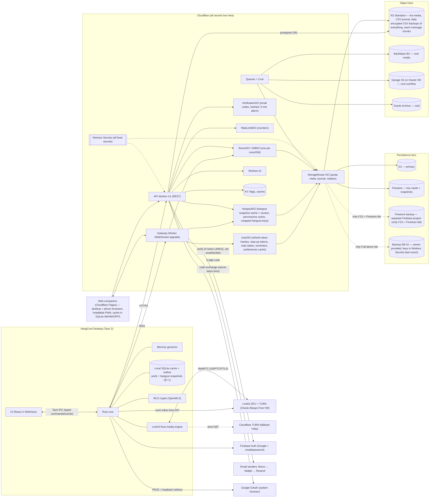
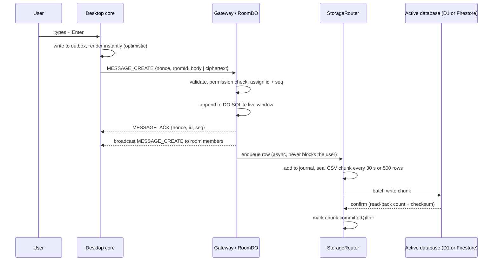
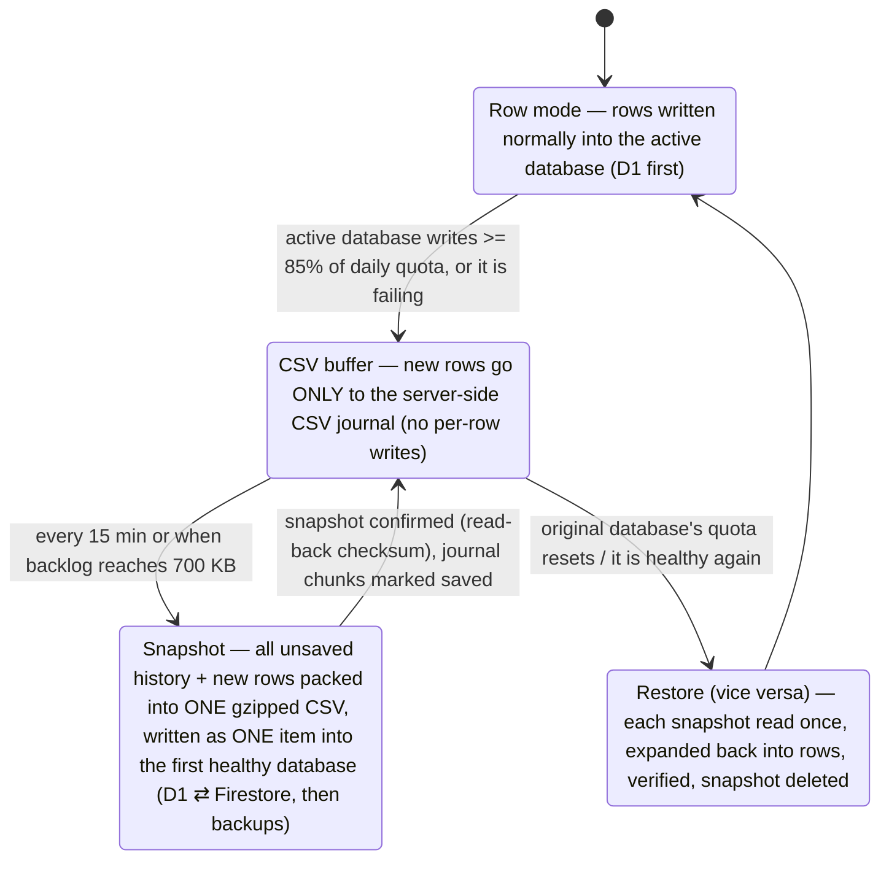
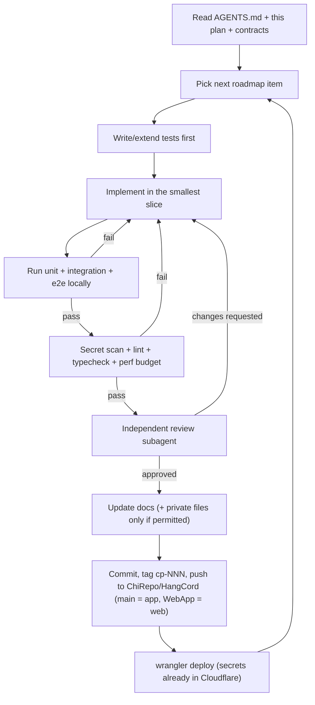
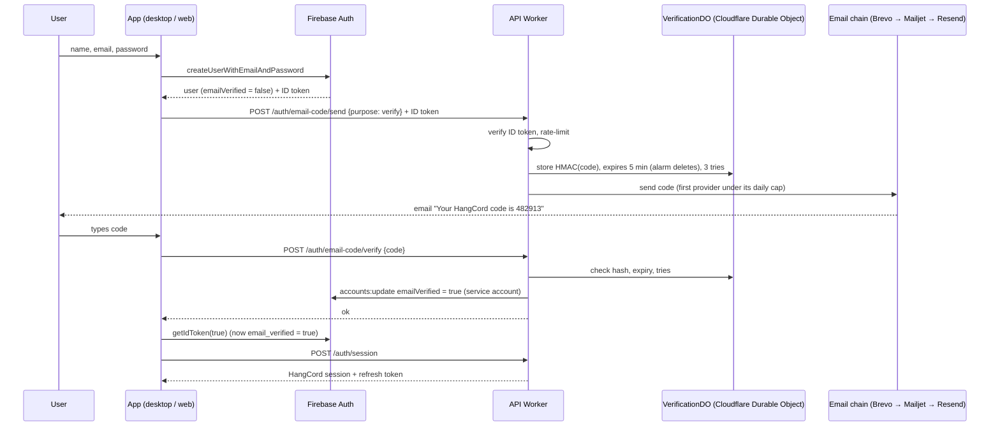

# HangCord — Master Plan

> **Read this first, agent.**
> You're about to build HangCord, a real app that real people will open every evening to hang out with their friends. That matters. You are fully capable of building it well, and you don't have to do it all at once. Work in small, verified steps. Run the code before you say it works. When you're unsure, look at the diagrams and the contracts in this repo instead of guessing; they exist so you never have to invent anything. If you get stuck, say so plainly — an honest "blocked on X" is worth more than a confident wrong answer. Every checkpoint you finish cleanly is one more thing that just *works* for someone. Take your time, be precise, and enjoy building something great.

Status: **Phase 0 — planning complete, no code yet.** Last updated 2026-10-21.

---

## Contents
1. What HangCord is (and is not)
2. Brand: complete re-branding from Discord
3. Feature specification
4. Tech stack and why
5. Workflow–API–App diagrams (source of truth)
6. API and realtime contract
7. Storage architecture: "Ground-to-Sky, free edition" (7.1 Caching: user preferences and hangouts)
8. Database rotation engine (Cloudflare D1 ⇄ Firestore, CSV snapshots)
9. Object storage plan
10. Free VoIP and realtime transport providers
11. Dynamic memory governor (≤ 1.7 GB)
12. Secrets and security (register: `SECRETS_AND_SENSITIVE_DATA.md`; CSV keys: §8.6)
13. Repository, checkpoints and pushing
14. Agent and subagent workflow
15. Testing and release gates (15.1 Mobile gate — every checkpoint)
16. Roadmap
17. Known limits and honest risks
18. Sources

---

## 1. What HangCord is (and is not)

- **A full, installable application**, not a web page. Primary target: native desktop app for **Windows, macOS and Linux** with installers, auto-update, system tray, native notifications, global push-to-talk hotkeys, `hangcord://` deep links, single-instance lock and start-on-login.
- **Plus a web companion** (same UI package, runs in the browser, hosted on Cloudflare Pages) for people who can't install the app. The desktop app is the flagship; the web companion must never drive design decisions that hurt the desktop app.
- **Clean-room.** HangCord reproduces the *publicly observable features and behaviour* of Discord plus improvements requested in user reviews. Agents must **not** decompile, copy or redistribute Discord code, assets, sounds, icons, fonts, copy text or trademarks. The REA reverse-engineering MCP (`morluto/rea`) may be used **only on HangCord's own builds** — e.g. confirming no secrets ship inside the bundle, inspecting our own network captures, profiling our own binaries.
- **Beta honesty.** The app openly tells users it is in development: a first-run "HangCord is in beta" sheet, a small persistent `BETA` pill in the title bar, and an in-app "Report a bug" flow. Copy (use as-is or refine):
  > "HangCord is still being built. Messages and streams may sometimes load slowly, and you might hit bugs or glitches. Your feedback shapes what we fix next — thanks for hanging out with us early."

## 2. Brand: complete re-branding

### 2.1 Identity
| Element | HangCord |
|---|---|
| Name | **HangCord** (one word, capital H and C) |
| Tagline | "Better place to hang out." |
| Logo concept | Two rounded speech bubbles tied together by a single looping cord forming a soft knot. Original artwork only. |
| Primary colour | **Lantern** `#F2A93B` (warm amber) — Calm Minimal, approved 2026-10-21 (was `#FF7A45`) |
| Accent | **Moss** `#34C77B` (online / success) |
| Danger / warning | Ember `#B8322C` fill, `#F0605A` text / Honey `#D9B54A` |
| Dark surfaces | Night `#111316`, Panel `#181B20`, Surface `#1D2026`, Raised `#22262D`, Line `#2A2F37` |
| Light surfaces | Paper `#FAF8F5`, Panel `#F1EEE9`, Raised `#FFFFFF`, Line `#E2DDD5` (not yet redesigned) |
| UI font | Space Grotesk (headings) + Inter (UI) (both OFL); code font JetBrains Mono (OFL) — was Manrope |
| Sounds | Original sound set (commissioned or generated). Never reuse Discord sounds. |
| Voice/tone | Friendly, short, plain-spoken. No jargon in user-facing copy. |

Full design system: `ui-ux/calm-minimal/DESIGN_SYSTEM.md` (look, shapes, motion, presence badges, accessibility).

Discord's blurple (`#5865F2`), its logo, the "Clyde"-style mascot and its sound set are off limits.

### 2.2 Vocabulary map (use these words everywhere in UI, code and docs)
| Discord term | HangCord term | Code identifier |
|---|---|---|
| Server | **Hangout** | `hangout` |
| Text channel | **Room** | `room` (type `text`) |
| Voice channel | **Lounge** | `room` (type `lounge`) |
| Stage channel | **Spotlight** | `room` (type `spotlight`) |
| Forum channel | **Board** | `room` (type `board`) |
| Announcement channel | **Bulletin** | `room` (type `bulletin`) |
| Thread | **Strand** | `strand` |
| Direct message | **DM** / **Chats** | `dm` |
| Activities | **Together** (watch, listen, whiteboard) | `together` |
| Nitro | **HangCord Plus** — *reserved, disabled* | `plus` |
| Boost | *reserved for Plus* | `plus.boost` |
| Go Live | **Go Live** is generic but prefer **Share screen** | `screenshare` |

### 2.3 The reserved "Plus" slot
Nitro is removed. A **flexible empty slot** is kept for a future paid tier:
- Feature flags `plus.*` exist and are all `false`. `GET /v1/me/entitlements` returns `{ "plus": false, "perks": [] }`.
- The UI keeps a "HangCord Plus — coming later" card in Settings and a placeholder spot on the profile card. Nothing is clickable-to-pay.
- Every limit that Plus might raise later (upload size, stream quality, emoji slots) reads from a single `limits` config served by the API, so a future Plus tier only changes config, not code.

## 3. Feature specification

### 3.1 Parity features (everything Discord users expect)
**Accounts & identity (Firebase Authentication — see §6.1):** Google sign-in; email + password sign-in; new email accounts confirmed with a 6-digit code sent by email; password reset by code; active-sessions list with remote logout; data export; account deletion. No other sign-in methods in v1. (2FA is deferred: Firebase TOTP MFA needs the paid Identity Platform upgrade.)
**Profiles:** avatar, banner, bio, pronouns, status (online / idle / do-not-disturb / invisible), custom status with expiry, per-hangout nickname and avatar, connections list.
**Friends:** requests, accept/decline, block, ignore, mutual friends and mutual hangouts.
**DMs:** 1:1 and group DMs (up to 10 people), **end-to-end encrypted** (see 3.2).
**Hangouts:** create, templates, invite links (expiry, max uses), categories, Rooms, Lounges, Spotlights, Boards, Bulletins (followable), welcome screen, rules screening, onboarding questions, scheduled events, vanity link (reserved for Plus).
**Roles & permissions:** permission bitfield, role hierarchy, colours, per-room overrides, timeouts, kick, ban, audit log, AutoMod (keyword lists, spam, mention-spam, link filters), slow mode, age-gated rooms. **Full spec — permission bits, computation, hierarchy, every role/room/hangout setting, hangout secret keys, step-up, audit chain: [`ACCESS_AND_SETTINGS.md`](ACCESS_AND_SETTINGS.md).**
**Messaging:** markdown, syntax-highlighted code blocks, mentions (@user, @role, @everyone, @here), replies, edit, delete, reactions, pins, forwarding, message links, link embeds (fetched by a Worker), attachments, voice messages, polls, stickers, custom emoji, GIF picker (provider key stays server-side), typing indicators, unread markers and mention badges, jump-to-unread, Strands, slash commands, bots and webhooks.
**Voice & video (Lounges):** voice activity and push-to-talk, noise suppression (RNNoise or DeepFilterNet — open source), echo cancellation, per-user volume, server mute/deafen, camera video, screen share with audio, soundboard, end-to-end encrypted calls.
**Notifications:** native desktop notifications, per-hangout and per-room levels, mute-until, @mention-only, badge counts.
**Settings:** themes (dark, light, high-contrast), compact mode, font scale, reduced motion, screen-reader labels, keybinds, audio/video devices, privacy and DM filters, language, developer mode.
**Safety:** report message/user/hangout, block, AutoMod, explicit-media blur (on-device model), rate limits.

### 3.2 Headline fixes for top Discord complaints
1. **Lightweight mode** — the app adapts its memory use to the machine (§11) and has a one-click "Lightweight mode" that forces the leanest profile. A live memory readout lives in Settings → Performance.
2. **Encrypted DMs** — DMs and group DMs use **MLS (RFC 9420)** through **OpenMLS** (Rust, compiles to WASM for the web companion). Keys stay on devices; the server stores and forwards ciphertext only. Multi-device via MLS key packages; optional passphrase-protected key backup; "verify safety number" screen. Search over encrypted DMs is local-only.
3. **Beta transparency** — first-run notice, `BETA` pill, bug-report flow with opt-in logs, public status page.

### 3.3 New features (HangCord originals)
| Feature | What it does | How |
|---|---|---|
| **Live translation** | Translate any message inline; "auto-translate this room for me" | Workers AI `m2m100-1.2b`, results cached by `hash(text, targetLang)`, per-user daily quota. Encrypted DMs: per-message opt-in with a clear warning (plaintext goes to the server), otherwise disabled. |
| **Watch / listen together** | Synced YouTube video or permitted audio inside a Lounge, host controls, queue | YouTube IFrame Player API; playback state lives in the Room's Durable Object with a server clock; clients correct drift beyond ±250 ms. Local files → use screen share. No DRM-protected services. |
| **Whiteboard in calls** | Shared drawing board inside a Lounge; export PNG/SVG | Excalidraw (MIT) + Yjs CRDT synced through the Room's Durable Object; snapshots saved to object storage. |
| **Schedule + reminders** | Schedule a message; "Remind me" on any message; read-later list | Durable Object alarms; reminders delivered as native notifications. |
| **Add from any category** | A round **+** on every category header adds a Room or Lounge inside it; choose "Follow category guidelines" or "Own guidelines", pre-selected from your preference | ACCESS_AND_SETTINGS §7.1; `POST /hangouts/:id/rooms` with `guidelines`; permission-gated (`MANAGE_ROOMS` on the category) |
| **Instant hangouts** | Hangouts and your preferences open instantly from cache, then quietly update | §7.1: device cache + HangoutDO/UserDO edge cache, versioned deltas on connect |
| **AI catch-up** | "Catch me up" on a room with many unread messages: short summary with links back to messages | Workers AI `llama-3.1-8b-instruct-fp8`; cached per (room, last message id); per-user daily quota. **Never** runs on encrypted DMs server-side. |

## 4. Tech stack and why

| Layer | Choice | Why |
|---|---|---|
| Desktop shell | **Tauri 2** (Rust core + system WebView) | Far lower RAM than Electron (Discord is Electron; RAM is its #1 complaint). |
| Media engine (desktop) | **LiveKit Rust SDK** (libwebrtc) inside the Rust core | WebRTC inside Linux's WebKitGTK webview is unreliable, so voice/video/screen run natively in Rust on all three OSes; the webview only draws UI. |
| UI | React + TypeScript + Vite, TanStack Virtual for lists, Zustand for state, CSS custom-property design tokens | Well-known to agents, virtualised lists keep memory flat. |
| Web companion | Same `packages/ui`, LiveKit JS SDK for media, hosted on Cloudflare Pages | One UI codebase. |
| Local data | SQLite (desktop, via the Rust core) / SQLite-WASM on OPFS (web) | Instant startup from cache, offline outbox. |
| Identity | **Firebase Authentication**: Google sign-in + email/password, with HangCord's own 6-digit email code for verification (§6.1) | Free on Spark; Firebase does the password hashing, so Workers stay inside their 10 ms CPU budget. Workers verify Firebase ID tokens. |
| Transactional email | Brevo → Mailjet → Resend (free tiers), fallback Firebase verification link | Sends the 6-digit codes; rotated by daily quota like the databases. |
| API + realtime | Cloudflare Workers + Durable Objects (WebSocket Hibernation API) | Edge-close, free tier, outgoing WebSocket messages free. |
| Persistence | **Two working databases:** Cloudflare D1 (primary, row mode) and Firestore (member key vaults + snapshot destination when D1 is out of writes); CSV snapshots move between them both ways. **Two backups used only if both fail:** a backup Firestore (separate Firebase project) and Backup DB #2 (owner supplies its API key at implementation) | See §8. |
| Objects | Cloudflare R2 → Backblaze B2 / self-hosted Garage on Oracle → Oracle Archive | See §7, §9. |
| Async jobs | Cloudflare Queues + Cron Triggers | Embeds, migrations, ageing, daily rotation. |
| AI | Cloudflare Workers AI | Free daily allocation, no keys in client. |
| Voice/video server | Self-hosted **LiveKit server** (Apache-2.0) on Oracle Cloud Always Free | See §10. |

**Decision gate (end of Phase 2):** if the Rust media path cannot do screen share *with audio* on Windows, macOS and Linux, the Lead agent stops and reports to the user. The fallback is an Electron shell with the same memory governor; the user decides.

## 5. Workflow–API–App diagrams (source of truth)

If code disagrees with these diagrams, the code is wrong or the diagram must be updated **first**, in the same PR.

### 5.1 System map


### 5.2 Sending a message


### 5.3 Daily rotation cycle (CSV snapshot technique)


### 5.4 Desktop app workflow (agent build loop)


## 6. API and realtime contract

The canonical contract lives in `packages/protocol/openapi.yaml` and `packages/protocol/gateway-events.ts`. **No endpoint or event may be used in code unless it exists there first.** Initial surface:

**REST (`https://api.hangcord.<domain>/v1`)** — all require `Authorization: Bearer <session>` except auth.
| Method & path | Purpose |
|---|---|
| `GET /health` | Liveness/config check, no auth; never names a missing secret |
| `POST /auth/session` | Exchange a Firebase ID token for a HangCord session (15 min) + refresh token. Refused with `403 email_unverified` for email/password users until the code is verified |
| `POST /auth/email-code/send` | Send a 6-digit code (purpose `verify` or `reset`). Rate-limited |
| `POST /auth/email-code/verify` | Check the code; on success the Worker marks the Firebase user `emailVerified` |
| `POST /auth/password-reset/confirm` | Code + new password → Worker updates the Firebase password |
| `POST /auth/google/exchange` | Desktop only: Google auth code + PKCE verifier → Google ID token (client secret stays in Workers secrets) |
| `POST /auth/refresh`, `POST /auth/logout` | Rotate / revoke |
| `GET /me`, `PATCH /me`, `GET /me/entitlements`, `GET /me/limits` | Profile, Plus slot, limits |
| `GET /me/preferences`, `PATCH /me/preferences` | User preferences; `ETag: "p:<version>"`, `If-None-Match` → 304, `PATCH` needs `If-Match` (412 on conflict → client merges per key) (§7.1) |
| `GET/POST /friends`, `DELETE /friends/:id`, `POST /blocks` | Friends |
| `POST /hangouts`, `GET /hangouts/:id`, `PATCH /hangouts/:id` | Hangouts |
| `GET/POST /hangouts/:id/rooms`, `PATCH /rooms/:id` | Rooms/Lounges/Boards; create takes `categoryId` + `guidelines: "category" \| "own"` (ACCESS_AND_SETTINGS §7.1) |
| `GET /hangouts/:id/snapshot` | Cacheable hangout bundle (hangout, categories + rooms tree, roles, my member record, my permission bits per room, emoji) with `ETag: "h:<id>:<version>"`; `If-None-Match` → 304 (§7.1) |
| `GET/POST /hangouts/:id/roles`, `PUT/DELETE /rooms/:id/overrides/:type/:targetId` | Permissions — full list in ACCESS_AND_SETTINGS §14 |
| `GET /rooms/:id/messages?before=&after=&limit=` | History (router decides tier) |
| `POST /rooms/:id/messages` | Fallback send when WebSocket is down |
| `PATCH/DELETE /messages/:id`, `PUT/DELETE /messages/:id/reactions/:emoji` | Edit/delete/react |
| `POST /attachments/presign` | Short-lived upload URL |
| `GET /attachments/:id` | Signed download URL (may return `202 restoring` for cold items) |
| `GET/POST /invites/:code` | Invites |
| `POST /voice/token` | LiveKit room token (10 min) + TURN credentials |
| `POST /translate` | Translation (quota) |
| `POST /rooms/:id/catch-up` | AI summary (quota) |
| `POST /scheduled`, `POST /reminders`, `GET /reminders` | Schedule & reminders |
| `POST /mls/key-packages`, `GET /mls/key-packages/:userId`, `POST /mls/welcome` | Encrypted DMs |
| `POST /reports` | Safety |
| `GET /flags` | Feature flags |

**Gateway (WSS)** ops: `HELLO`, `IDENTIFY` (carries `cache: {prefsVersion, hangouts: {id: version}}`), `READY` (sends only what changed since those versions, §7.1), `HANGOUT_UPDATE`, `ROOM_CREATE/UPDATE/DELETE`, `PREFERENCES_UPDATE`, `HEARTBEAT`/`HEARTBEAT_ACK`, `RESUME`, `MESSAGE_CREATE/UPDATE/DELETE`, `MESSAGE_ACK`, `REACTION_ADD/REMOVE`, `TYPING_START`, `PRESENCE_UPDATE`, `READ_STATE`, `VOICE_STATE`, `TOGETHER_STATE`, `BOARD_UPDATE` (Yjs binary), `NOTIFY`, `MLS_COMMIT`, `SYSTEM_NOTICE` (e.g. "HangCord is busy").

### 6.1 Authentication (Firebase Authentication)

Sign-in methods in v1 — **only these three flows**:
1. **Continue with Google**
2. **Sign in with email + password**
3. **Create account with email + password, confirmed by a 6-digit code sent by email**

Firebase project settings: enable the Email/Password and Google providers; keep "one account per email address" on; restrict the API key to the HangCord app origins; Firestore rules deny all client access (only Workers talk to Firestore).

**Create account (email + code)**


Rules for the code flow:
- Codes are 6 random digits from `crypto.getRandomValues` (rejection sampling, never `Math.random()`), stored only as `HMAC-SHA256(EMAIL_CODE_PEPPER, code|purpose|uid)`, valid **5 minutes**, **3 wrong tries** then the code is burned. Compare in constant time.
- Codes live **only on Cloudflare**, in a **`VerificationDO`** Durable Object (one per `HMAC(EMAIL_CODE_PEPPER, normalised email)`): `{codeHash, purpose, uid, expiresAt, attempts, sendsThisHour, hourStart, lastSentAt}` — never the plain code or the plain email. Durable Objects are private to the Worker, encrypted at rest, and single-threaded, so parallel guesses can't race past 3 tries. A DO alarm deletes the record at expiry; it's deleted immediately on success. Not Firestore (outside Cloudflare), not KV (eventually consistent, 1,000 writes/day free). Full register: [`SECRETS_AND_SENSITIVE_DATA.md`](SECRETS_AND_SENSITIVE_DATA.md).
- Sending: the request must carry a Firebase ID token for that account (sign-up creates the account first), or pass Cloudflare Turnstile for password reset. A new code can be requested after 60 s, at most 5 per email per hour, plus per-IP limits. A new code replaces the old one but **does not reset the hourly send count**, so resending can't buy unlimited guesses.
- Responses never reveal whether an email has an account ("If that email is registered, we sent a code").
- Backend is **Cloudflare Workers**, not Firebase Cloud Functions: Cloud Functions need the paid Blaze plan, and HangCord keeps Firebase on the free Spark plan. Email goes out through each provider's HTTPS API (Brevo, Mailjet, Resend), not SMTP.
- Email provider rotation works like the database rotation: the Worker counts sends per provider per day and moves to the next one before the cap. If all are used up, it calls Firebase `sendEmailVerification` (free link, 1,000/day on Spark) and the app shows "We sent you a link instead — open it, then come back."
- Email/password users can't get a HangCord session until verified. Unverified accounts older than 24 h are deleted by a Cron job.
- **Password reset** uses the same code (`purpose: reset`) followed by `POST /auth/password-reset/confirm`, so Firebase's 150 reset emails/day isn't the bottleneck; Firebase's reset link is the fallback.
- Email copy: from `HangCord <no-reply@[YOUR DOMAIN]>`, subject "Your HangCord code: 482913", plain text + simple HTML, no links needed. Set up SPF, DKIM and DMARC on the domain so codes don't land in spam.

**Continue with Google**
- **Web companion:** Firebase `signInWithPopup` (fallback `signInWithRedirect` following Firebase's third-party-storage best practices).
- **Desktop app:** popups don't work inside the Tauri webview. The Rust core opens the system browser to Google with **PKCE** and a **loopback redirect** (`http://127.0.0.1:<random port>`), using a Google OAuth client of type **Desktop app**. The core receives the auth code, sends it with the PKCE verifier to `POST /auth/google/exchange` (the client secret stays in Workers secrets), gets back the Google ID token, and the UI calls Firebase `signInWithCredential(GoogleAuthProvider.credential(idToken))`.
- Google accounts are already email-verified; no code needed.
- If the email already exists with a password, handle `auth/account-exists-with-different-credential` by asking for the password once and linking both methods to one account.

**Sessions**
- The Firebase ID token is only used to obtain a HangCord session; the app talks to HangCord APIs with the HangCord session (15 min) + rotating refresh token, stored in the OS keychain on desktop (Rust `keyring` crate) and in memory + httpOnly cookie on web.
- Signing out revokes the HangCord refresh token and calls Firebase `signOut`.

## 7. Storage architecture: "Ground-to-Sky, free edition"

This keeps the lifecycle idea from the owner's private storage diagram (data cascades from hot to cold automatically; media goes straight to object storage via signed URLs; lifecycle jobs age it down) and swaps the paid parts (AWS Glacier / Scaleway Glacier, multi-year hot database) for free providers.

| Layer | What lives there | Where | Latency |
|---|---|---|---|
| **Ground 0 — device** | Recently viewed messages, media thumbnails, outbox | Local SQLite + disk cache | Instant |
| **Ground 1 — live edge** | Last ~500 messages per room, presence, typing, journal | Durable Object SQLite | ms |
| **Ground 2 — hot DB** | All messages until D1 storage reaches 70%, then oldest days age out (target ≥ 90 days hot) | D1 primary / Firestore spill | ms |
| **Sky 1 — warm** | Messages older than hot window as daily compressed chunks (`.csv.gz`), media 0–30 days, **all thumbnails forever** | R2 Standard | ms–100 ms, fetched on scroll-back straight into the client cache |
| **Sky 2 — cool** | Media older than 30 days | Backblaze B2, overflow to Garage on the Oracle VM | ms–100 ms (no restore step) |
| **Sky 3 — cold** | Messages older than 2 years, media older than 1 year | Oracle Object Storage **Archive** tier (restore ≤ 1 hour), plus a second copy of message archives in Backblaze B2 (file storage, not a database) | up to 1 hour |

Rules:
- Ageing is done by a Cron-triggered **Mover** Worker using Queues, because R2 lifecycle rules can't move objects to another provider, and R2's own Infrequent Access class isn't covered by the free tier.
- For cold items the API returns `202 restoring`; the UI shows the thumbnail with "Bringing this back from the archive — usually under an hour. We'll notify you." Never a blank or broken tile.
- Encrypted DM content is ciphertext at every layer.
- The routing index (`location` table in D1: `room_id, day, tier, object_key, checksum`) is the only way code finds data. Never hard-code a tier.

### 7.1 Caching: user preferences and hangouts (owner request, 2026-10-21)
Goal: opening HangCord, switching hangouts and opening settings is instant, works offline (read-only), and saves free-tier reads. Hangouts ("servers") are cached exactly the way user preferences are: a versioned copy on the device and at the edge, kept fresh by small deltas.

| What | Device (Ground 0) | Edge | Authoritative | Version |
|---|---|---|---|---|
| **User preferences** — theme, density, font scale, reduced motion, language, notifications, keybinds, Lightweight mode, `rooms.newRoomGuidelines`, per-hangout/per-room prefs (collapsed categories, mute, sort) | SQLite `prefs` (desktop) / SQLite-WASM on OPFS, IndexedDB fallback (web) | `UserDO` memory + DO storage | D1 `user_prefs` | `prefsVersion` (+1 per change) |
| **Hangout snapshot** — hangout meta, categories + rooms tree with guidelines, roles (name, colour, position), my member record, my permission bits per room (cosmetic only), custom emoji (members load separately, with presence) | SQLite `hangout_snapshot` per hangout | `HangoutDO` memory + DO storage | D1 `hangouts`, `rooms`, `roles`, `members`, `overrides` | `hangoutVersion` (+1 per change); `permVersion` for permission changes |

**How it stays fresh**
1. **Start-up:** the app paints from the device cache immediately (no spinner when a cache exists), then connects.
2. **Connect:** `IDENTIFY` sends `{prefsVersion, hangouts: {id: version}}`. `READY` returns only what changed: a list of patches when the gap is ≤ 50 versions, otherwise a full snapshot. Unknown or removed hangouts come back as `removed` and are wiped locally.
3. **Live:** `HANGOUT_UPDATE {hangoutId, version, permVersion?, patch}`, `ROOM_CREATE/UPDATE/DELETE`, `PREFERENCES_UPDATE {version, set}` keep caches current. A version gap (missed event), a `permVersion` change, or a patch that would break the snapshot's shape → re-fetch `GET /hangouts/:id/snapshot` or `GET /me/preferences` with `If-None-Match`. Every patched snapshot is re-validated against the contract schema before it's kept. A deleted preference is a tombstone `{value: null, updatedAt}` so an older copy elsewhere can't bring it back.
4. **Preference edits** apply locally first (optimistic), then `PATCH /me/preferences` with `If-Match`; on `412` the client merges per key (newest timestamp wins) and retries. Another device gets `PREFERENCES_UPDATE`.
5. **Edge:** `HangoutDO` and `UserDO` serve snapshots from memory; on a cold start they rebuild from D1 once and keep it (D1 reads saved on every reconnect). Every change is written to D1 through the StorageRouter (CSV journal first, §8.5), then the version is bumped and the delta is broadcast. KV holds only **public** invite previews (name, icon, member count; 60 s TTL) — never access data.

**Safety rules**
- The cache never decides access: every action is checked by `computePermissions()` on the server. A `permVersion` change makes the client re-fetch the snapshot instead of keeping or guessing permission bits (READY's patch list carries `toPermVersion` for the same check).
- Kicked, banned or left → the server sends `removed` for that hangout and the device wipes its snapshot, messages and media cache for it. Sign-out wipes all caches on that device.
- Nothing secret is cached: no hangout keys, tokens, email codes or other users' private data. Encrypted DMs stay ciphertext. The device cache file is encrypted with a per-device key (OS keychain on desktop; a non-extractable WebCrypto key on web).
- Caches register with the memory governor (§11); the in-memory part shrinks first in Yellow/Red. On disk: up to 50 hangout snapshots (LRU), 20 on phones.
- `user_prefs` is a normal table: journaled and included in the daily encrypted CSV export (§8.5).
- Shared logic lives in `packages/cache` (version compare, patch apply, merge, LRU, wipe rules) so desktop, web and phones behave identically.

## 8. Database rotation engine

The owner first named three stores: **Firestore**, **Cloudflare Pages** and **GitHub hosting**. Cloudflare Pages is static hosting and cannot take writes, so it maps to **Cloudflare D1** on the same account (Pages still hosts the web companion). On 2026-10-21 the owner decided on **two working databases — Cloudflare D1 and Firestore — plus two backups used only when both fail**: a backup Firestore (another Firebase project) and Backup DB #2, whose provider and API key the owner will supply during implementation. GitHub holds only the code repo "Hangcord"; **no user data ever goes to GitHub.**

| Database | Role |
|---|---|
| **Cloudflare D1** | primary, row mode; holds Firestore's snapshots when Firestore is out of writes |
| **Firestore** | members' private key vaults (ACCESS_AND_SETTINGS §10.2); holds D1's snapshots when D1 is out of writes |
| **Firestore backup** (separate Firebase project, Spark plan, its own free quota) | backup #1 — receives snapshots **only when D1 and Firestore have both failed or run out of writes** |
| **Backup DB #2** (provider + API key supplied by the owner at implementation) | backup #2 — last resort, **only when D1, Firestore and the Firestore backup have all failed** |

### 8.1 Daily free capacity (verify before relying on it — see Sources)
| Tier | Writes/day | Reads/day | Storage | Reset |
|---|---|---|---|---|
| D1 | 100,000 rows | 5,000,000 rows | 5 GB | 00:00 UTC |
| Firestore (Spark) | 20,000 docs | 50,000 docs | 1 GiB | midnight (Firebase docs; confirm the time zone, historically US Pacific) |
| Firestore backup (separate Spark project) | 20,000 docs | 50,000 docs | 1 GiB | same as Firestore |
| Backup DB #2 | set when the owner supplies it | — | — | — |

Row mode always uses **D1** (the highest-request database). Snapshots go down this ladder to the first healthy database — D1's data: **D1 → Firestore → Firestore backup → Backup DB #2**; Firestore's data (member key vaults): **Firestore → D1 → Firestore backup → Backup DB #2** — and come back to their home database after each reset. The two backups are never used while D1 or Firestore can take a snapshot.

### 8.2 How it works
1. **Live delivery never waits on persistence.** A message is acknowledged once it is in the Room DO's SQLite and broadcast.
2. **Journal = the server-side CSV.** The StorageRouter DO appends every accepted row — of **every** table and collection, not just messages (§8.5) — to a journal and seals it into CSV chunks (RFC 4180, every 30 s or 500 rows), gzips them and **encrypts them with the routine CSV key** (§8.6), stored in R2 at `journal/YYYY-MM-DD/NNNNNN.csv.gz.enc` with a SHA-256 checksum of the plain CSV.
3. **Flush** each sealed chunk to the active database in **row mode** (D1 batch insert) while it has headroom. When it doesn't, switch to **snapshot mode** (§8.3): rows stay in the CSV journal and are written to another database as one snapshot item — never as per-row writes.
4. **Confirm** by read-back (row count + checksum). Only then mark the chunk `committed@<tier>` in the routing index.
5. **Quota meter:** the Router counts its own usage per tier per provider day and also treats provider errors (`429`, `RESOURCE_EXHAUSTED`, D1 limit errors) as "full". Switch at **85%** so reads and deletes keep headroom.
6. **Restore after reset (vice versa):** when the original database's quota resets or it is healthy again, a Queue job reads each snapshot (one read), expands it back into normal rows in batches that respect that database's quota, verifies row count + checksum, updates the routing index, then deletes the snapshot (a safety copy of each snapshot is kept in R2 for 7 days). It continues until done or the database reaches 85% again, then resumes next reset. This loop runs forever in the background.
7. **Daily truncate:** at 00:15 UTC the Router deletes the previous day's journal chunks **only if every chunk is committed and verified**. Any unconfirmed chunk is kept and retried. Never delete unconfirmed data.
8. **All four full or down** (D1, Firestore, Firestore backup, Backup DB #2): the journal keeps accepting (DO SQLite has 5 GB) and realtime delivery continues; persistence catches up after the next reset. Users see nothing unless the Workers/DO request quota itself is exhausted, in which case they see a calm `SYSTEM_NOTICE`: "HangCord is very busy right now — messages may be slow."
9. **Invisible to users:** clients read history through `GET /rooms/:id/messages`; the API resolves the tier via the routing index. Users never see tier names.

### 8.3 Snapshot mode — one write per database (owner's CSV technique)
**When:** the active database has used ≥ 85% of its daily writes, **or** it is *fully dysfunctional*: quota exhausted / limit errors (`429`, `RESOURCE_EXHAUSTED`, D1 limit errors), 3 failed writes within 60 s, or its health probe failing for 2 minutes.

**What happens:**
1. No more per-row writes to any database. Every new row (messages, edits, deletes, member changes waiting to be copied, vault-key updates, tombstones) goes only into the **server-side CSV journal** (StorageRouter DO SQLite + sealed chunks in R2), which already holds all history not yet saved anywhere.
2. Every 15 minutes, or as soon as the unsaved backlog reaches **700 KB gzipped**, the StorageRouter (inside the Durable Object, which has the CPU budget for compression) builds a **snapshot**: one RFC 4180 CSV of *all* unsaved history + new rows, gzipped, with a header line `{snapshotId, createdAt, fromDb, firstSeq, lastSeq, rowCount, sha256}`.
3. The snapshot is written as **exactly one item** into the first healthy database on the ladder — D1's data: **D1 → Firestore → Firestore backup → Backup DB #2**; Firestore's data (member key vaults): **Firestore → D1 → Firestore backup → Backup DB #2**:

   | Destination | The one write |
   |---|---|
   | Cloudflare D1 | one row in `csv_snapshots(id, created_at, from_db, first_seq, last_seq, row_count, sha256, bytes BLOB)` |
   | Firestore | one document `csvSnapshots/{id}` with a `bytes` field |
   | Firestore backup | one document `csvSnapshots/{id}` with a `bytes` field, in the backup Firebase project |
   | Backup DB #2 | one write through the `SnapshotStore` adapter (`put` / `get` / `delete` / `health`) — implemented only when the owner supplies the provider and key; agents must not pick a provider themselves |

   Snapshots are capped at 700 KB gzipped so one item fits both databases (Firestore's limit is 1 MiB per document). Firestore's 1 GiB storage holds snapshots only until they're restored into D1. A backlog bigger than that becomes the fewest possible snapshots — still one write each, thousands of rows per write.
4. **Confirm** by reading the item back once and checking `rowCount` + `sha256`. Only then are those journal chunks marked `saved@snapshot:{db}:{id}`; the daily truncate may delete them only after this.
5. The routing index records which rows live in which snapshot, so history stays readable: a read of an old range loads that snapshot once, unpacks it in the Durable Object, and caches it.
6. **Vice versa:** once the original database is healthy (normally at its quota reset), §8.2 step 6 expands each snapshot back into proper rows/documents there, verifies, and deletes the snapshot. Firestore-native data (members' vault key copies, ACCESS_AND_SETTINGS §10.2) that was parked in a D1 snapshot is expanded back **into Firestore**; D1 data parked in a Firestore snapshot goes back **into D1**. A safety copy of every snapshot is kept in R2 for 7 days.
7. Restoring from a backup works the same way: when the home database is healthy again, each snapshot in the Firestore backup or Backup DB #2 is read once, expanded back home, verified, then deleted from the backup.
8. If every database is down (all four), the journal simply keeps growing (Durable Object storage) and nothing is lost; snapshots resume as soon as any database accepts one write.
8. Snapshots contain only what the rows already contain: message bodies are encrypted (room data keys), vault key copies are wrapped, proofs are MACs. **No plain secrets ever enter a CSV.**
9. Invisible to users: the API, the app and the messages look the same in every mode.

### 8.4 Security of tiers
- Firestore security rules deny **all** client access in **both** Firebase projects (main and backup); only the Worker (service-account JWT, token cached in KV) reads/writes.
- Backup credentials (`FIRESTORE_BACKUP_SA_JSON`, `BACKUP2_ENDPOINT`, `BACKUP2_API_KEY`) are Workers Secrets of the storage-router only, set by the owner with `wrangler secret put`; never in code, config, docs, logs or the client. If Backup DB #2's secrets are absent, the router simply skips that rung.
- Never write user data into the code repo "Hangcord".

### 8.5 CSV backups of everything (owner's rule: if anything fails, there is a CSV)

> **Order of daily jobs (fixed 2026-10-21 after review):** the encrypted daily export runs at 01:00 UTC and **journal chunks are truncated only after they are both committed to a database and contained in a verified export** (01:30 UTC tick). The journal is never truncated before the export that relies on it.

Two layers, both CSV, both on Cloudflare first with a second copy elsewhere:

**Layer 1 — write-ahead CSV journal for every write.** *Every* write HangCord makes to *any* database goes into the CSV journal **before** it is applied — not only messages. That includes users and profiles, hangouts and settings, rooms and overrides, roles and role assignments, members and memberships, bans, invites, audit-log entries, AutoMod rules, events, reminders and scheduled messages, read states, reactions and pins, Strand metadata, whiteboard snapshots metadata, Together queues, attachment metadata (object key, tier, size, SHA-256), wrapped hangout keys (authoritative records, still encrypted), members' vault copies (still encrypted), deletes and tombstones. Each journal row = `{seq, at, db, table/collection, op (insert|update|delete), primary key, columns as JSON}`. If a database write then fails, the row is still in the journal and is replayed (or snapshotted, §8.3). Access data still **fails closed** while D1 is down — the journal guarantees it can be rebuilt, not that it's used for access checks.

**Layer 2 — daily full CSV export of every table and collection.** At 01:00 UTC a Queue job exports, for each database (D1, Firestore, Firestore backup if used, Backup DB #2 if used) and each Durable Object class that holds durable data (HangoutDO wrapped keys, StorageRouter routing index), one CSV per table/collection:
- Path: `backups/csv/YYYY-MM-DD/{db}/{table}.csv.gz.enc` plus `backups/csv/YYYY-MM-DD/manifest.csv` (file, row count, SHA-256 of the plain CSV, schema version).
- Format: RFC 4180, UTF-8, first line = column names + `schema_version`, gzipped, then **encrypted for emergencies only** with the emergency public key (§8.6). Normal HangCord servers cannot open these files; only the emergency decryption key can.
- Large tables are split into ≤ 50 MB parts (`{table}.part0001.csv.gz.enc` …) and exported in pages within each database's daily read quota (D1: 5M rows read/day; Firestore: 50k reads/day — Firestore is exported incrementally from the journal, not by full reads, to stay inside quota).
- Stored in **R2** (Cloudflare) and copied to **Backblaze B2** (second provider). Retention: 7 daily, 4 weekly, 6 monthly; older ones deleted after the next export is verified.
- Verified after writing: each file is read back, decrypted in memory, its SHA-256 and row count compared with the manifest. A failed verification raises an owner alert and the previous good backup is kept.

**Not backed up (on purpose):** short-lived security data — email-code HMACs, step-up tokens, refresh-token hashes, rate-limit counters. After a disaster restore, people simply sign in again. The KEK and the emergency key are never in any CSV. The owner keeps an **offline copy of every `HANGCORD_KEK_V{n}` and every `CSV_EMERGENCY_PRIVATE_KEY_V{n}`** (e.g. a password manager) — without them, encrypted data and backups can't be read.

**Restore runbook (practised in staging every month):**
1. Pick the newest verified daily export (manifest checks pass).
2. Open the emergency window (§8.6) and let the emergency-restore Worker decrypt each file in memory, checking SHA-256 + row count.
3. Recreate each table/collection in the target database (D1 or Firestore, or the backups) in quota-sized batches — or, if a database's writes are out, load it as CSV snapshots (§8.3).
4. Replay the Layer 1 journal from the export's last `seq` to now.
5. Run the reconcilers (membership vaults, routing index, audit-log hash chain) and the key self-checks (ACCESS_AND_SETTINGS §10.6) before reopening access.

### 8.6 CSV encryption and the emergency decryption key (owner's rule)

**Every CSV is encrypted.** There are two keys, so the backups can't be opened during normal operation at all:

| CSV | Encrypted with | Who can decrypt |
|---|---|---|
| Live journal chunks (`journal/…`) and snapshots (in D1, Firestore, the backups) — needed for routine replay/restore | **Routine CSV key** `CSV_ROUTINE_KEY` (32 random bytes, AES-256-GCM, AAD = `kind\|date\|id`) | the storage-router Worker only |
| Daily backups (`backups/csv/…` in R2 + B2) and the 7-day safety copies of snapshots | **Emergency public key** `CSV_EMERGENCY_PUBLIC_KEY_V{n}` (RSA-OAEP-4096 / SHA-256) wrapping a fresh AES-256-GCM key per file | **nobody in normal operation** — only the emergency private key can open them |

**The emergency decryption key** (`CSV_EMERGENCY_PRIVATE_KEY_V{n}`, PKCS#8, ~3.2 KB — fits the 5 KB Workers Secret limit):
- Generated **by the owner on their own computer** (never by an agent), e.g.
  ```bash
  openssl genpkey -algorithm RSA -pkeyopt rsa_keygen_bits:4096 -out emergency_v1.pem
  openssl pkey -in emergency_v1.pem -pubout -outform DER | base64 | tr -d '\n' > public_v1.b64      # → CSV_EMERGENCY_PUBLIC_KEY_V1 (storage-router)
  openssl pkcs8 -topk8 -nocrypt -in emergency_v1.pem -outform DER | base64 | tr -d '\n' > private_v1.b64  # → CSV_EMERGENCY_PRIVATE_KEY_V1 (emergency-restore only)
  ```
  then set with `wrangler secret put`, keep **one offline copy** (password manager or printed in a safe), and securely delete the local files.
- Stored **only** as a Workers Secret of a separate Worker, `workers/emergency-restore`, which has **no public route** (`workers_dev = false`, no routes). No other Worker, Durable Object, database, CSV, repo or client ever holds it.
- The storage-router holds only the **public** key: it can lock new backups but can never unlock any.
- Each encrypted backup file carries `{v, alg, keyId, date, db, table, wrappedKey, iv}`; `keyId` = first 8 bytes of SHA-256 of the public key, so the right private key version is picked. AAD = `date|db|table|keyId` — a renamed or moved file fails to decrypt.

**Break-glass procedure (emergencies only — data loss or corruption the routine snapshots can't fix):**
1. The owner opens an emergency window: `wrangler` command that sets `emergency_until` (≤ 2 hours) in the emergency-restore Worker's Durable Object, plus a fresh step-up email code.
2. The owner triggers the restore through a temporary, Cloudflare Access-protected route (owner's account only) or `wrangler` — never from the app.
3. The emergency-restore Worker decrypts files **in memory only**, checks them against the manifest, and writes the data back into the databases (MASTER_PLAN §8.5 runbook). Plain CSV is never written anywhere.
4. Every use is recorded in the audit log and emailed to the owner. When the window ends, the Worker refuses all requests again.
5. Afterwards the owner rotates the pair (`_V{n+1}`): new backups use the new public key; the old private key stays offline until the backups it can open have expired (6 months).

## 9. Object storage plan

| Provider | Free allowance | Role |
|---|---|---|
| **Cloudflare R2** | 10 GB-month, 1M Class A + 10M Class B ops per month (≈ 33k writes and 333k reads per day averaged), **free egress** | Primary hot: new media, thumbnails, journal, warm message chunks |
| **Backblaze B2** | First 10 GB free; Class A/B/C calls free, Class D first 2,500/day free; egress free up to 3× stored (and free via Cloudflare partner routes) | Cool media tier |
| **Garage** (self-hosted S3, on the Oracle VM's 200 GB block storage) | Bounded by VM; Oracle egress up to 10 TB/month | Cool overflow, large exports, whiteboard snapshots |
| **Oracle Object Storage** | 20 GB total across Standard/IA/Archive, 50k API requests/month | Cold archive only (low request count suits rare restores) |

Best free per-day throughput for hot traffic: **R2** (operations) and the **Oracle VM** (raw bandwidth). Not chosen: Firebase Storage (needs the paid Blaze plan), Supabase Storage (1 GB, 50 MB file limit), Storj (no durable free tier), Scaleway (no confirmed free tier; its Glacier class is paid).

Upload policy (free, no Plus): 25 MB per file default (from `/me/limits`), client-side image compression to WebP/AVIF, per-user storage quota 500 MB. All uploads use presigned URLs valid 5 minutes; keys never reach the client.

## 10. Free VoIP and realtime transport providers

| Need | Provider | Free allowance | Notes |
|---|---|---|---|
| SFU (group voice/video/screen) | **LiveKit server, self-hosted** on **Oracle Cloud Always Free** Ampere A1 VM | 4 OCPU, 24 GB RAM, 10 TB egress/month | Apache-2.0; built-in TURN/TLS; Docker Compose in `infra/livekit/`. Requires card verification; check Oracle's idle-reclamation policy and keep a health check. |
| TURN fallback | **Cloudflare Realtime TURN** | 1,000 GB/month shared with Cloudflare SFU | Credentials minted by the API Worker (1 h). |
| STUN | Own LiveKit + `stun.cloudflare.com` | Free | |
| Dev / emergency SFU | LiveKit Cloud Build plan | ~5,000 WebRTC minutes/month (third-party figure — confirm) | Development only. |
| Signalling / "TCP/IP" realtime | **Cloudflare Workers + Durable Objects WebSockets** (TLS over TCP) | 100k requests/day; incoming WS messages billed 20:1; outgoing free | Use the Hibernation API so idle sockets cost nothing. |

E2EE calls: SFrame-style insertable-streams encryption with keys from the room's MLS group (same idea as Discord's DAVE protocol, implemented independently).

## 11. Dynamic memory governor (≤ 1.7 GB)

The Rust core detects total and available RAM (`sysinfo` crate) and picks a budget for **the whole app process tree** (Rust core + WebView processes + media):

| Total RAM | Budget | Profile |
|---|---|---|
| ≤ 4 GB | 300 MB | Lite |
| 4–8 GB | 500 MB | Balanced |
| 8–16 GB | 800 MB | Smooth |
| 16–32 GB | 1.2 GB | Rich |
| ≥ 32 GB | **1.7 GB (hard ceiling)** | Max |

Effective budget = `min(profile, 25% of currently available RAM, 1.7 GB)`, floor 250 MB, re-evaluated every 10 s. Lightweight mode forces Lite.

What the budget controls: messages kept per room (200 → 2,000), number of rooms kept "hot" (3 → 20), decoded image cache, avatar cache, neighbour-room prefetch, list overscan, video tiles decoded at once (4 → 25) and simulcast layer chosen, whiteboard history depth, translation cache.

Enforcement loop (every 5 s, sampling RSS of all app processes):
- **Green** (< 70%): grow caches toward the budget.
- **Yellow** (70–90%): evict LRU caches, stop prefetch, lower hidden video layers.
- **Red** (> 90%): unload background rooms, stop off-screen video, ask WebView to trim (WebView2 `MemoryUsageTargetLevel = Low` on Windows), force JS-side cache clear.

Release gate: 8-hour soak test with 50 rooms and a 10-person call must stay under budget on 4, 8, 16 and 32 GB profiles.

## 12. Secrets and security
- **No secret ever goes in the client, the repo, logs, or any markdown file.** Third-party keys (Firebase/Firestore service account, Google OAuth client secret, Brevo / Mailjet / Resend API keys, email-code pepper, the hangout key-encryption key `HANGCORD_KEK_V1`, Turnstile secret, B2 keys, LiveKit API key/secret, Cloudflare TURN key, GIF provider key) are stored with `wrangler secret put` (encrypted Workers secrets), each only in the Worker that needs it. Cloudflare Secrets Store is still open beta and isn't used yet. R2, D1, KV, Queues and Workers AI are accessed through bindings, which need no key.
- **Changing sensitive data** (email codes, step-up tokens, refresh-token hashes, rate-limit counters, wrapped hangout keys) lives only in **Durable Object storage** on Cloudflare, with HangCord's own HMAC/encryption on top. Firestore, KV, R2, GitHub and logs never hold secrets.
- **The full list of every secret and sensitive item, where it lives, who reads it and when it rotates: [`SECRETS_AND_SENSITIVE_DATA.md`](SECRETS_AND_SENSITIVE_DATA.md).** Anything not listed there must not be stored.
- Local development uses `.dev.vars`, which is git-ignored. `.dev.vars.example` lists names only.
- Firebase's web config `apiKey` is a public project identifier, not a secret; still serve it from the API config endpoint and lock everything with security rules.
- Clients only ever hold short-lived tokens: session 15 min (rotating refresh), LiveKit token 10 min, presigned URLs 5 min, TURN credentials 1 h.
- Pre-commit **gitleaks**; GitHub secret scanning + push protection; CI fails on any finding; a release step scans the built desktop bundle for key patterns.
- Per-user and per-IP rate limits in the API Worker; input validation with shared schemas (zod) from `packages/protocol`.
- DAST scan of the API on every release candidate.

## 13. Repository, checkpoints and pushing

Repository: **`ChiRepo/HangCord`** on GitHub. Branches: **`main` = the real application** (desktop app + shared code), **`WebApp` = web companion work**, merged into `main` when ready. Releases: tag `vX.Y.Z` → installers for Windows/macOS/Linux on a GitHub Release. Layout:
```
HangCord/
  AGENTS.md                 # rules every agent follows
  README.md
  docs/MASTER_PLAN.md       # this file
  apps/desktop/             # Tauri 2 app (src-tauri = Rust core)
  apps/desktop/ui/          # the desktop app's screens (React); the web companion lives on the WebApp branch
  packages/ui/              # shared React UI + design tokens
  packages/protocol/        # openapi.yaml, gateway-events.ts, zod schemas
  packages/cache/           # preference + hangout cache core (versions, patches, merge, LRU, wipe) — §7.1
  packages/crypto/          # MLS bindings (Rust + WASM)
  workers/api/              # REST Worker
  workers/gateway/          # WebSocket Worker + Durable Objects
  workers/storage-router/   # StorageRouter DO, Mover, rotation jobs, CSV journal/snapshots/backups (encrypt-only for backups)
  workers/emergency-restore/ # break-glass only: holds the emergency CSV decryption key, no public route
  infra/livekit/            # docker-compose for the Oracle VM
  tests/ui/                 # Playwright: desktop screens at 1440 / 1024 / 480 px windows (phones: WebApp branch)
  tests/desktop/            # desktop e2e: the built app via tauri-driver + WebKitWebDriver
  tools/policy/             # repo rules as tests (secrets, crons, private folders, mobile, Graphify)
  graphify/                 # code map (Graphify, local only): graph/GRAPH_REPORT.md, graph.html, graph.json, refresh.sh
  .github/workflows/        # ci.yml (every push/PR), release.yml (v* tag → installers on a GitHub Release)
  Private files (.md files store here)/   # git-ignored, AI access restricted
  private and only to be accessed once…/  # git-ignored, holds rules.md (read once per session)
```

**Checkpoint** (numbering and current status: §16.1 — checkpoint 1 = foundation, **checkpoint 1.1 = the real desktop application**) = a vertical slice that builds, passes all tests, lint, typecheck, secret scan and perf budget, and is documented. After every checkpoint:
1. Run the full test suite and record the result — on `WebApp` this includes the mobile gate (§15.1).
2. Run gitleaks; abort on any finding.
3. Update `docs/` (and the private files **only** if write permission was granted — see AGENTS.md).
4. Commit with a conventional-commit message, tag `cp-NNN`.
5. Push to `ChiRepo/HangCord` (`main` for the application, `WebApp` for web-companion work) when the owner asks; any unpushed work is pushed before new work starts (owner rule 2026-10-22). Refresh the code map first (`npm run graph`, `graphify/README.md`).
6. Deploy Workers with `wrangler deploy` (secrets already stored in Cloudflare; never passed on the command line or committed).

## 14. Agent and subagent workflow

**One Lead agent** owns the plan, the roadmap order, merges and the push (when the owner asks, §13 step 5). Subagents get narrow tasks:

| Subagent | Owns | Never touches |
|---|---|---|
| Architect | `packages/protocol`, diagrams | app code |
| UI | `packages/ui`, `apps/desktop/ui` (web companion: `WebApp` branch) | Workers |
| Desktop core | `apps/desktop/src-tauri` (governor, cache, IPC) | Workers |
| Cache | `packages/cache` (shared cache logic, §7.1) | UI, Workers |
| Backend | `workers/api`, `workers/gateway` | storage-router internals |
| Data | `workers/storage-router`, migrations | UI |
| Media | LiveKit integration, `infra/livekit` | protocol without Architect |
| Crypto | `packages/crypto`, MLS flows | everything else |
| QA | `tests/`, CI | production code |
| Security reviewer | read-only review, fresh context | writes nothing |
| Docs/Handoff | `docs/`, private files (only with permission) | code |

Rules:
- The Lead hands each subagent: the goal, exact files/dirs in scope, the relevant contract sections, and acceptance tests.
- Subagents run in parallel only on non-overlapping directories (separate git worktrees).
- Every subagent returns: files changed, commands run **with their real output**, tests passing/failing, open risks. No "should work".
- Contracts change only through the Architect, and diagrams update in the same PR.
- A reviewer that did not write the code verifies each checkpoint.
- Any provider limit or API detail must cite a docs URL; package versions must be checked in the registry, never guessed.
- If blocked for more than two attempts, stop and report to the user instead of improvising.

## 15. Testing and release gates
- Unit: Vitest (TS), `cargo test` (Rust).
- Integration: `wrangler dev` / Miniflare with local D1, Firestore emulator, MinIO-compatible local S3 for B2/Garage paths.
- E2E: Playwright (web); WebdriverIO + `tauri-driver` (desktop on Windows/Linux; macOS has no WebDriver support in Tauri, so use a manual + scripted smoke checklist there).
- Load: k6 WebSocket tests on the gateway; LiveKit `lk load-test` for media.
- CSV encryption: no CSV file anywhere is plain text; the storage-router cannot decrypt a backup (public key only); the emergency-restore Worker refuses outside an open emergency window; renamed/moved backup files fail to decrypt; journal chunks and snapshots round-trip with the routine key.
- CSV backups: every table/collection appears in the daily export; each export decrypts and matches its manifest; a full restore from CSV + journal replay into empty D1 and Firestore reproduces the same data (row counts, checksums, audit-chain verification); short-lived security data is absent from every CSV.
- Chaos: force each database "full" and "down" (one at a time, D1 + Firestore together, and all four together) and verify: the backups receive snapshots only when D1 and Firestore have both failed; restore empties the backups; no message is lost; snapshot mode starts at 85% or on failure; each snapshot is exactly one write and ≤ 700 KB; read-back checksum gates journal truncation; history inside snapshots stays readable; restore expands every snapshot back and deletes it; vault-key snapshots return to Firestore.
- Memory soak (§11), accessibility (axe), security (gitleaks, `cargo audit`, `npm audit`, DAST).
- Performance targets (measured, not promised): send→echo p95 < 150 ms on the same continent; cold start < 1.5 s on an 8 GB machine; message list scrolls at 60 fps.

### 15.1 Mobile gate — every checkpoint (owner request, 2026-10-21)
_Since 2026-10-22 the web companion lives on the `WebApp` branch, so this gate runs there; `main` (the desktop app) tests narrow windows instead (§13)._
Every checkpoint must also work well on phones. In v1, phones use the **web companion** (installable PWA) on iOS Safari and Android Chrome; native iOS/Android builds with Tauri 2 mobile are a later decision for the owner, so all shared code (`packages/ui`, `packages/protocol`, `packages/cache`) stays free of desktop-only assumptions.

A checkpoint passes the mobile gate only when, for every screen or flow it touches:
1. **Layout:** works at 360×740, 390×844 and 430×932 (portrait) and in landscape; no horizontal scroll; respects safe areas (`env(safe-area-inset-*)`); uses `100dvh`, not `100vh`; the keyboard never covers the composer or a form's submit button.
2. **Navigation:** one pane at a time on phones — hangouts + rooms drawer → room → members/details sheet; bottom tab bar with ≤ 5 items (Home, Chats, Notifications, You); system back/swipe-back goes back one level; deep links work.
3. **Touch:** targets ≥ 44×44 px with ≥ 8 px gaps; nothing is hover-only (long-press opens the same menu as right-click); every swipe has a button alternative.
4. **Performance (measured):** web shell initial JS ≤ 200 KB gzipped; LCP < 2.5 s and INP < 200 ms on a mid-range Android profile (Lighthouse mobile throttling); 60 fps message scrolling; phones use the Lite memory profile (≤ 300 MB, §11).
5. **Network:** survives flaky mobile data — WebSocket `RESUME` after the tab is backgrounded or the network changes; outbox keeps unsent messages; optional data saver (no autoplay, thumbnails until tapped).
6. **Platform limits handled honestly:** features a phone browser can't do are hidden with a short note, never broken (e.g. screen share on iOS browsers). Web Push on iOS works only for home-screen web apps (iOS 16.4+, https://webkit.org/blog/13878/web-push-for-web-apps-on-ios-and-ipados/).
7. **Tests:** Playwright runs every e2e in `desktop-chromium`, `mobile-chrome` (Pixel 7) and `mobile-safari` (iPhone 15, WebKit) projects; axe runs on the phone layout; the Lighthouse mobile budget runs in CI.
8. **Design:** every new screen has a phone artboard (390×844) in the design canvas before it is built.

## 16. Roadmap
### 16.1 Checkpoint numbering (owner decision, 2026-10-21)
| Checkpoint | Tag | What it is | Status |
|---|---|---|---|
| **1** | `cp-001` | Phase 0 foundation: monorepo, CI, API/gateway contract, Calm Minimal tokens, `packages/cache` core, Workers hello-world (fail-closed secrets), web companion shell, LiveKit config, policy tests, mobile gate | **done 2026-10-21** (pushed to `ChiRepo/HangCord` `main`, 2026-10-22) |
| **1.1** | `cp-001.1` | **The real-world desktop application** — `apps/desktop`, a Tauri 2 app for Windows, macOS and Linux that runs the shared UI. Rust core with typed IPC, memory governor v1 (§11), encrypted local SQLite cache behind `packages/cache` (preferences + hangout snapshots, §7.1), single instance, remembered window state, instant start from cache, installers | **Linux done 2026-10-22** (Rust 21 tests, desktop e2e 13/13 on the test build and on the installed `.deb`, `.deb` + AppImage built); **waiting:** macOS `.dmg` built + manual checklist on the owner's Mac, Windows `.msi`/NSIS from CI |
| **2** | `cp-002` | Server core: Firebase ID token → HangCord session (15 min) + single-use refresh (UserDO, reuse detection); `/me`, preferences (ETag/If-Match), hangouts + snapshot (ETag), **+ room** wired to `planNewRoom` + `computePermissions`; D1 schema; every write journaled in the same D1 batch | **done 2026-10-22** |
| **2.1** | `cp-002.1` | Realtime: one `HangoutDO` per hangout (WebSocket Hibernation) — HELLO/IDENTIFY/READY (cache-aware), MESSAGE_CREATE → ACK + broadcast to members who can VIEW the room, nonce de-dupe, rate limit; REST history + fallback send on the gateway; bodies encrypted with room data keys (KEK → hangout key → HKDF room key), D1 persist after delivery, journaled. _Design note: one DO per hangout (not per room) keeps Durable Object count and requests inside the free plan; split per room later if a hangout gets hot._ | **done 2026-10-22** |
| 2.2 | `cp-002.2` | Desktop app goes live: Google (system browser + PKCE loopback) and email/password sign-in, session in the OS keychain, real data instead of the sample, live chat | next |
| 2.3 | `cp-002.3` | Email codes (VerificationDO + Brevo → Mailjet → Resend), password reset, unverified-account cleanup | later |
| 3 → | `cp-003`… | Rest of Phase 1, then Phases 2–6 | later |

Checkpoint 1.1 exit criteria: the desktop app builds and launches on Linux in CI and on the owner's Mac; a restart shows the last hangout and preferences from the encrypted local cache with no spinner; the governor picks the right budget for the machine's RAM and reports live usage; `cargo test` + `npm run checkpoint` pass; the Linux installer (`.deb` / AppImage) builds; macOS (`.dmg`) is built by the owner on the Mac and Windows (`.msi`/NSIS) by CI. The mobile gate (§15.1) still applies to every shared-UI change.

Every phase's exit criteria **also** require the mobile gate (§15.1) for everything that phase touches.

| Phase | Scope | Exit criteria |
|---|---|---|
| 0 | Repo, CI, contracts, design tokens, Workers hello-world, secrets in place, Oracle VM + LiveKit up; web shell + `packages/cache` (preference + hangout cache core, §7.1) | CI green, LiveKit reachable, zero secrets in repo; web shell passes the mobile gate |
| 1 | Accounts (Google + email/password + email code, §6.1), hangouts, rooms (incl. **+ add from category**, ACCESS_AND_SETTINGS §7.1), realtime messaging, local cache (prefs + hangout snapshots wired end-to-end, §7.1), desktop shell, governor v1, router v1 (D1 + journal) | Two desktop clients **and a phone browser** chat in real time; restart shows hangouts and preferences instantly from cache |
| 2 | Lounges: voice, video, screen share (+ decision gate), soundboard, TURN fallback | 10-person call stable 1 h on all 3 OSes |
| 3 | Encrypted DMs (MLS), friends, notifications | Server sees ciphertext only (verified by test) |
| 4 | Full rotation (D1 ⇄ Firestore, CSV snapshots + restore), object tiers + Mover, roles/permissions, moderation | Chaos tests pass |
| 5 | Schedule + reminders, translation, AI catch-up, Together (watch/listen), whiteboard | Feature e2e tests pass |
| 6 | Hardening, accessibility, installers, code signing, auto-update, beta launch | All release gates green |

## 17. Known limits and honest risks
- **Cloudflare free plan allows only 5 Cron Triggers per account** (https://developers.cloudflare.com/workers/platform/limits/, checked 2026-10-21). Every timed job (snapshot flush, health probe, rebalance, Mover, journal truncate, daily CSV export, vault sweep) runs from **one** 15-minute cron in the storage-router (`workers/storage-router/src/jobs.ts`); `tools/policy` fails if the account total goes above 5.
- **Workers free plan: 100,000 requests/day for the whole account, shared with Pages Functions** — keep the web companion static on Pages and send API calls to the API Worker. This is the first ceiling for a growing beta.
- **Free tiers cap scale.** The tightest limit is 100k Workers/DO requests per day; expect a beta in the low thousands of daily users at most, not Discord scale. Measure and revisit.
- **Firebase Auth on Spark** lists a daily-active-user limit (3,000/day for standard sign-in), 1,000 verification emails/day, 150 password-reset emails/day and 100 new accounts/hour per IP. The free email chain gives roughly 600 codes/day (Brevo 300 + Mailjet 200 + Resend 100) before falling back to Firebase links. Cloudflare's own Email Sending is beta and needs the paid Workers plan, so it isn't used.
- **Oracle Always Free** needs card verification, ARM capacity can be scarce in some regions, and idle instances may be reclaimed; keep monitoring and a documented rebuild script.
- **Databases** (owner's decision, 2026-10-21): two working databases (D1, Firestore) plus two backups used only when both fail (Firestore backup project, Backup DB #2 from the owner). Only if all four are out at once do rows wait in the CSV journal (Durable Object storage) — nothing is lost, but saving is delayed. GitHub and TiDB were considered and dropped. Backup DB #2 can't be built or tested until the owner supplies its provider and key.
- **Code signing:** macOS needs an Apple Developer ID ($99/year) for notarisation or users get Gatekeeper warnings; unsigned Windows builds trigger SmartScreen. Free route for open-source projects: SignPath Foundation.
- **"Zero issues / zero lag"** cannot be guaranteed by any system. The plan gets as close as possible through optimistic UI, local cache, tests and measured budgets.
- **Legal:** clean-room only; no Discord trademarks; publish a privacy policy and terms; follow India's DPDP Act 2023 (verifiable parental consent for users under 18) and set a minimum age.

## 18. Sources
- REA: https://github.com/morluto/rea
- Cloudflare Workers / KV / D1 / DO free limits: https://developers.cloudflare.com/workers/platform/pricing/
- Durable Objects WebSocket billing: https://developers.cloudflare.com/durable-objects/platform/pricing
- Cloudflare Realtime SFU/TURN pricing: https://developers.cloudflare.com/realtime/sfu/pricing
- Workers AI pricing: https://developers.cloudflare.com/workers-ai/platform/pricing/
- R2 pricing: https://developers.cloudflare.com/r2/pricing
- Firebase pricing: https://firebase.google.com/pricing
- Backblaze B2 pricing: https://www.backblaze.com/cloud-storage/pricing
- Oracle storage tiers: https://docs.oracle.com/iaas/Content/Object/Concepts/understandingstoragetiers.htm
- Oracle Always Free breakdown: https://selfhost.it.com/blog/oci-free-tier-breakdown
- Tauri WebRTC on Linux discussion: https://github.com/tauri-apps/tauri/discussions/8426
- Free object storage comparison: https://merginit.com/blog/17062026-free-object-storage-comparison
- LiveKit free plan (third-party summary): https://agentdeals.dev/vendor/livekit
- Firebase Auth limits: https://firebase.google.com/docs/auth/limits
- Firebase redirect best practices: https://firebase.google.com/docs/auth/web/redirect-best-practices
- Google OAuth loopback for desktop apps: https://developers.google.com/identity/protocols/oauth2/resources/loopback-migration
- Free email sending tiers 2026: https://freetier.co/articles/free-email-sending-tiers-2026
- Cloudflare Email Service changelog: https://developers.cloudflare.com/changelog/product/email-service/
